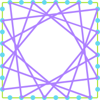
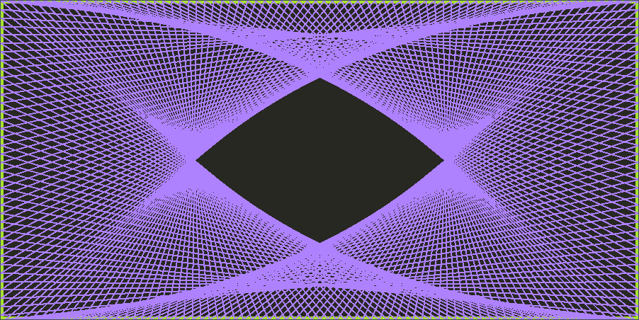
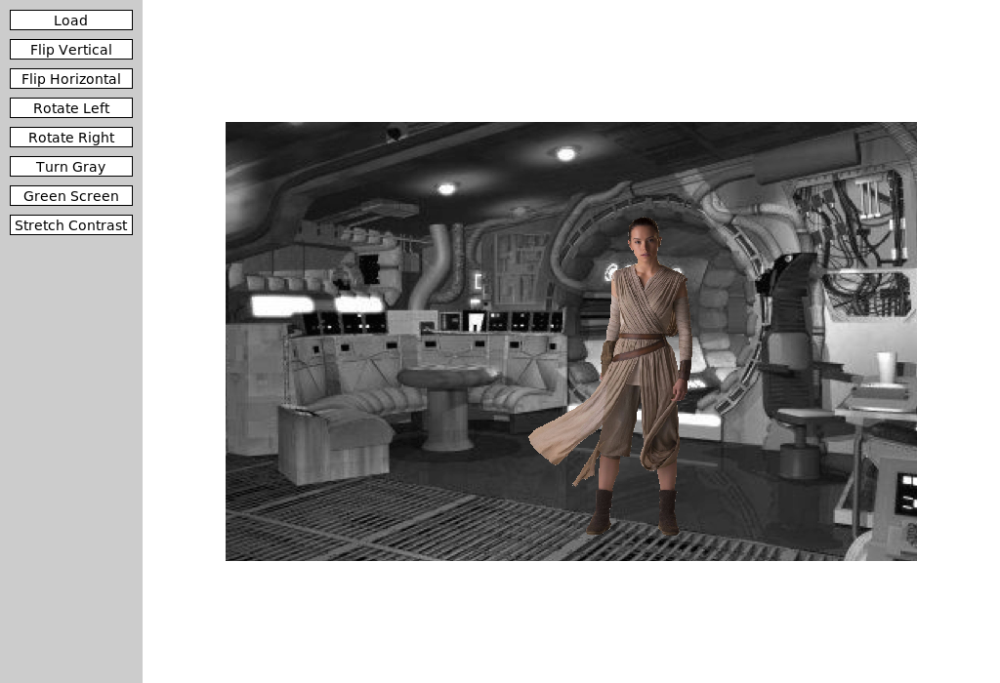
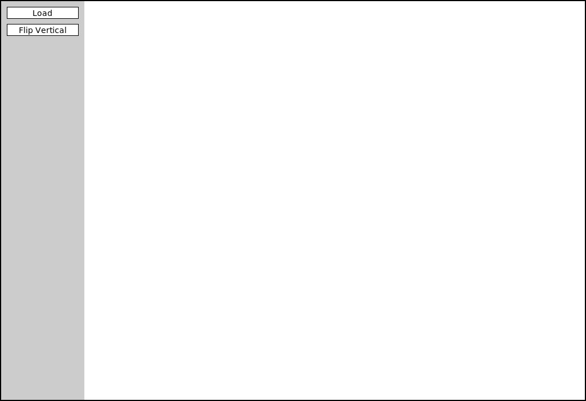

## Happy Week 10! 

- No Group activity today but personal review prompts!
	- We will resume group activities on Wednesday!

<!-- ::::{style='font-size:.8em'}
- Class grouping today: Scan the QR code or go to [https://tools.jedrembold.prof/daily](https://tools.jedrembold.prof/daily)
- Class code is `TUPLE`
- Introduce yourselves! What is your most valuable academic record?
::::

::::::cols

::::col
{width=60%}
::::
::::col
{width=60%}
::::
:::::: -->

---


## Quick Announcements
- We are in Chapter 10 of the reading material
- Problem set 5 is due ***today at 10pm!***
- Project __ImageShop__ is published today and due next week Monday
	- Again, begin to work on it from tomorrow to remain on target
	- Section meeting this week will provide more useful tools on the project
- Second midterm exam is ***next week Friday 6th of November***. 
	- __More details next week__


---

## Reading & Writing with PGL
- Last week we introduced reading and wrting files from the terminal 
- We can make it more interactive from the GUI with the help of `pgl` 
- This approach will be helpful in your __ImageShop__ project

## Choosing Wisely
:::{.sml style="font-size: 45px;"}
- The Python package used to implement `pgl.py` also supports a mechanism to choose files interactively, made available through the `filechooser.py` library module.
- `filechooser.py` exports two functions:
	- `choose_input_file` for selecting a file
	- `choose_output_file` for selecting a folder and filename to save a file to
- Both open up a file dialog that lets you select/choose a file
	- Clicking Open or Save returns the full pathname of the file
	- Clicking Cancel returns an empty string

- Using it thus looks something like:
```python
filename = choose_input_file()
with open(filename) as f:
	# Code to read file
```
:::

## Writing to File with Filechooser
- Grab the `filechooser.py` from ***Canvas -> Modules -> Week 10 -> Additional Resources*** 
```python
# Ensure you import the methods from filechooser
from filechooser import choose_input_file, choose_output_file
filename= choose_output_file()
try:
    with open(filename, "a") as fh:
        fh.write("Here is a new text")
except IOError:
    print("The file location is not correct")

```


 <!-- ## Writing ASCII SINE
- Suppose I wanted to try my hand at some ASCII art and fill a text file with a vertical oscillating sine wave
- A sine wave generally looks like:
	$$ A + A \sin\left(\frac{2\pi}{T}x\right)$$
  where $A$ is the amplitude of the wave and $T$ the period of the wave, or how quickly it repeats
  - The extra $A +$ out front is to push the wave over to the right, since we can't really place negative characters
- How can we put this together?


## ASCII SINE Code
```{.python style='font-size:.6em; max-height:900px;'}

from math import sin, pi

def sine_file(filename, A, T, symbol, padding=" "):
    """ 
    Creates a new sine wave in the provided file with the provided amplitude (A),
    and period (T) with the indicated symbol at the end.

    Inputs:
        filename (string): the name of the file to write the art to
        A (int): the amplitude of the wave in terms of number of characters
        T (int): the period of the wave in terms of number of lines
        symbol (string): the symbol to place to mark the wave
        padding (string): what character to pad the left side of the wave with

    Outputs:
        None
    """

    def compute_symb_placement(A, T, x):
		"""Computes where the symbol should be placed."""
        value = A * sin(2 * pi / T * x) + A
        return int(value) # to integer character placement

    def construct_line(placement, symbol, padding):
		"""Constructs the line with the necessary padding and symbol at the end."""
        return padding * placement + symbol

    with open(filename, 'w') as fh:
        for x in range(10 * T): # write 10 periods worth of lines
            v = compute_symb_placement(A, T, x)
            line = construct_line(v, symbol, padding)
            fh.write(line + '\n') # need the newline character at the end!

if __name__ == '__main__':
    sine_file('sine_test.txt', A=30, T=50, symbol='X')
```

--- -->

## Review Question! {data-notes="Solution: B"}
:::{.sml style="font-size: 43px;"}
Suppose you had the file contents to the left and wanted to turn it into the contents on the right. Which code snippet below would accomplish this?

::::::cols
::::col

```{.python style='align:left;'} 
food
```
::::

::::col
```{.python style='align:right;'} 
fooddoof
```

::::
::::::

::::::cols
::::col

:::{.block name=Option_A}
```python
with open(file) as fh:
    data = fh.read()
with open(file, 'w') as fh:
    fh.write(data[::-1])
```
:::

:::{.block name=Option_B}
```python
with open(file) as fh:
    data = fh.read()
with open(file, 'a') as fh:
    fh.write(data[::-1])
```
:::


::::

::::col

:::{.block name=Option_C}
```python
with open(file, 'rw') as fh:
    data = fh.read()
    fh.write(data[::-1])
```
:::

:::{.block name=Option_D}
```python
with open(file) as fh:
    data = fh.read()
with open(file, 'a') as fh:
    fh.write(data[-2::-1])
```
:::

::::
::::::
:::

---

## Its a Record!
::::::{.cols style='align-items: center'}
::::col
- A record is a collection of related fields treated as a single unit
	- Imagine a row in a spreadsheet or database
	- Or a single observation
- A record stores what the state of something was, and thus generally doesn't change

::::

::::col

::::
::::::


<!-- ## Old Records
- Records are a very old idea, dating back to the 19th century BCE
- In 2017, researchers established that the below tablet, called the Plimpton 322 tablet, records Pythagorean triples!

{width=50%} -->


## Recording Dickens
- Suppose we had some records from the two-employee firm Scrooge and Marley
- Each contains the employee name, their title, and their salary

\begin{tikzpicture}%%width=70%
[record/.style={draw, minimum width=4cm, font=\tt},
lab/.style={font=\tt\small, anchor=south west},
]
\node[record, MGreen](n) at (0,0) {"Ebenezer Scrooge"};
\node[lab, MGreen](nl) at (n.north west) {name};
\node[record, MGreen, below=.75cm of n](t){"founder"};
\node[lab, MGreen] at (t.north west) {title};
\node[record, MGreen, below=.75cm of t](s) {1000};
\node[lab, MGreen] at (s.north west) {salary};
\node[fit=(nl)(s), draw, very thick, MGreen] {};

\node[record, MBlue](n) at (5,0) {"Bob Cratchit"};
\node[lab, MBlue](nl) at (n.north west) {name};
\node[record, MBlue, below=.75cm of n](t) {"clerk"};
\node[lab, MBlue] at (t.north west) {title};
\node[record, MBlue, below=.75cm of t](s) {15};
\node[lab, MBlue] at (s.north west) {salary};
\node[fit=(nl)(s), draw, very thick, MBlue] {};

\end{tikzpicture}

---

## Tuple Time
- In Python, the simplest strategy for representing a record uses the built-in type _tuple_
	- Comes from terms like _quintuple_ or _sextuple_, that denote fixed-size collections
- An ordered, **immutable** sequence of values
- Feel similar to lists, except immutable, and thus used very differently
	- Think of tuples as records 
- Created by enclosing a collection of elements in parentheses
`employee = ("Bob Cratchit", "clerk", 15)`{.inlinecode}
- Stored internally similarly to a list, so each element has a corresponding index

---

## Tuple Usage
- Can largely envision tuples as sitting between strings and lists
	- Immutable, like strings
	- Elements can be _anything_, like lists
- Common operations mimic that of strings
	- Can concatenate with addition
	- Can duplicate by multiplying by an integer
	- Can index and slice them
	- Can loop over them directly or via index
- A tuple of a single value **needs** a comma at the end in order to be a tuple

---

## Tuple Selection
- You can select or slice elements from a tuple just like you can with lists
	- Unfortunately, records are not usually ordered in a particular way. Rather, it is the field name that is usually important
- If using tuples, you can make programs more readable by using a _destructuring assignment_, which breaks a tuple into named components:

  ```python
  name, title, salary = employee
  ```

- While modern versions of Python have such thing as a _named tuple_, we will not look at them here.
	- The more general strategy is to define a new data type (class) to better represent the objects in question

---

## Pointy Tuples!
::::::{.cols style='align-items:center'}
::::col
- One of the most simple examples of tuple usage would be storing location information in 2d space
- By storing both $x$ and $y$ coordinates in a tuple, it makes that information easier to store and pass around your program
- When you need to use the points, best to destructure:
  ```python
  x,y = pt
  ```
::::

::::col

\begin{tikzpicture}%%width=80%
\draw[very thick, MGreen] (0,0) rectangle + (5,5);
\node[circle, fill=MRed, label={[MRed]below right: ($x_1$,$y_1$)}, minimum size=5pt, inner sep=0pt] at (3,4) {};
\node[circle, fill=MBlue, label={[MBlue]below right: ($x_2$,$y_2$)}, minimum size=5pt, inner sep=0pt] at (2,1) {};
\end{tikzpicture}

::::
::::::

---

## Returning Tuples
- Tuples give us a convenient way to return multiple objects from a function
  - `return x, y` is the same as `return (x,y)`
- Several Python built-in functions return tuples, of which a few are particularly useful
	- `enumerate`
	- `zip`

---

## Enumerating
- We have multiple ways to iterate through a string or list:
	- By element:
	
	  ```python
	  for ch in string:
		  # body of loop using ch
	  ```

	- By index:
	
	  ```python
	  for i in range(len(string)):
		  # body of loop using i
	  ```
- Using `enumerate` lets us get both!
  ```python
  for i, ch in enumerate(string):
      # body of loop using both ch and i
  ```

---

## Zipping
- Sometimes you have multiple lists that you want to loop over in a "synced" fashion
- The `zip` function iterates through tuples of pairs of elements
- For example
  ```python
  zip([1,2,3], ["one", "two", "three"])
  ```
  would yield `(1, "one")`, then `(2, "two")`, and then `(3, "three")`
- Can unpack or destructure as part of a `for` loop:
  ```python
  for x,y in zip([1,2,3],[4,5,6]):
	  # body of loop using paired x and y
  ```

---

## Demo Yarn Tuples
::::::cols
::::col
- Points often show up in graphical applications, where you may want to store a host of locations in a list
- A pretty example of points involves making some yarn art, where we:
	- Place a set of "pegs" at regular intervals around a border
	- Tie a piece of "yarn" around one peg
	- Loop the yarn around the peg a distance `DELTA` ahead
	- Continue until we return to where we started
::::

::::col

::::
::::::

---

## Expanding...

{width=100%}

---

## In Code
```{.python style='max-height:800px; font-size:.8em; width:100%; margin: auto;'}
from pgl import GWindow, GLine, GRect

PEG_SEP = 3
PEG_ACROSS = 300
PEG_DOWN = 150
DELTA = 332

GWIDTH = PEG_ACROSS * PEG_SEP
GHEIGHT = PEG_DOWN * PEG_SEP

def place_pegs():
    """ Returns a list of points, where the points are tuples. """
    list_pts = []
    for i in range(PEG_ACROSS):
        list_pts.append((i * PEG_SEP, 0))
    for i in range(PEG_DOWN):
        list_pts.append((GWIDTH, i * PEG_SEP))
    for i in range(PEG_ACROSS):
        list_pts.append((GWIDTH - i * PEG_SEP, GHEIGHT))
    for i in range(PEG_DOWN):
        list_pts.append((0, GHEIGHT - i * PEG_SEP))
    return list_pts

def draw_pattern(list_pts, color='black'):
	""" Creates a window and draws in the necessary yarn. """
    gw = GWindow(GWIDTH, GHEIGHT)
    current_i = 0
    finished = False
    while not finished:
        next_i = (current_i + DELTA) % len(list_pts)
        x1, y1 = list_pts[current_i]
        x2, y2 = list_pts[next_i]
        line = GLine(x1, y1, x2, y2)
        line.set_line_width(2)
        line.set_color(color)
        gw.add(line)
        current_i = next_i
        if current_i == 0:
            finished = True

if __name__ == '__main__':
    pegs = place_pegs()
    draw_pattern(pegs, 'green')
```

---


## TYK Review: Tuple Tactics
::::::{.cols style='align-items: center'}
::::col
What would the code to the left print off?

:::poll
#. `2`
#. `4`
#. `6`
#. This would error
:::
::::

::::col
```python
A = (1, 2, (3, 4))
B = A[1::2]
x, y, z = A
for i in range(x):
	B += z
print(y * B[-2])
```
::::
::::::

---

## Introducing ImageShop Project!
::::::cols
::::col
- While you are refreshed from spring break, the next project is starting today and will be due next week Monday
- Taking a moment today to introduce Imageshop, and the guide is already posted
::::

::::col

::::
::::::

---

## Starting
::::::cols
::::col

::::

::::col
- ImageShop initially has only two buttons
	- "Load" will bring up a file selection box where you can chose what image to display
		- Internally, this is handled by a function that returns the chosen file path
	- "Flip Vertical" is the example feature button that flips an image vertically
::::
::::::

---

## Big Picture
:::{.sml style="font-size: 45px;"}
- Each milestone in ImageShop boils down to:
	- Adding a button to the window to handle a new feature
	- Writing a simple callback function that sets the new image to be equal to the output of a new function you'll write
	- Writing that function, which will return a `GImage` type object
- You are always free to write whatever other helper functions you might like!
- ImageShop is the first project to start leveraging multi-file layouts:
	- Some functions will already be provided in `GrayscaleImage.py` that you can import into your main program
	- You are encouraged to write the necessary functions for Milestone 5 in their own file and import them in accordingly
	- To avoid scrolling madly around trying to find the code you want, this helps with that!
:::

---

## GButtons
- To help facilitate working with buttons, ImageShop introduces a new type called `GButton`
- Each `GButton` gets a label and a callback function name that determines what function is called when that button is clicked
- ImageShop will come with a pre-defined `add_button` function which will take care of adding a new button to the correct part of the screen.
	- You'll just need to provide it a label and function name to callback to

---

## The Current Image
- ImageShop holds the `GImage` currently displayed on the window in a variable called `gw.current_image`
- The variable is specifically added as an attribute to `gw` so that you will have access to it in any callback function you write
- This will generally be the input to your manipulation functions, since most work with whatever image was currently displayed on the screen
- Your callback function will run `set_image` on the output of your manipulation function, which will take care of updating the value of `gw.current_image`

---

## Milestone 1
- Milestone 1 has you adding a "Flip Horizontal" button
	- Add the button
	- Add the action callback function
	- Write a function to manipulate the pixels to flip the image horizontally
- Slightly more complicated than the example function, but not much

---

## Milestone 2
::::::{.cols style='align-items: center'}
::::col
- Here you will add buttons to rotate the image left or right (or CW or CCW if you prefer)
- Most of the difficulty comes in keeping track of rows and columns
	- Need to create a new list of lists of the correct dimensions
	- Need to copy over the pixels from the original to the needed location in the new list
::::

::::col
\begin{tikzpicture}%%width=100%
	\foreach[evaluate={\c=int(60-12*\x)}] \x in {0,1,...,5} {
		\foreach \y in {0,1,2} {
			\node[minimum size=10mm, draw, fill=MGreen!\c, font=\tt\scriptsize](A\x\y) at (1.1*\x,-1.1*\y) {[\y][\x]};
		}
	}
	\foreach \x in {0,1,2} {
		\foreach[evaluate={\c=int(12*\y)}] \y in {0,1,...,5} {
			\node[minimum size=10mm, draw, fill=MGreen!\c, font=\tt\scriptsize](B\x\y) at (10+1.1*\x,-1.1*\y) {[\y][\x]};
		}
	}
	\foreach[evaluate={\y=int(5-\x)}] \x in {0,1,...,5} {
		\draw[ultra thick, -stealth, MBlue] ($(A\y0.center)-(0,.2)$) -- (B0\x);
	}
\end{tikzpicture}

::::
::::::

---

## Milestone 3
- Here you'll add a button to convert an image to grayscale
- If you understand the other library files that have been given to you as part of the project, this project should be the simplest!

---

## Milestone 4
:::{.sml style="font-size: 48px;"}
- Here you get to enable a green screen effect!
- Unlike other buttons, when this one is clicked, you should use the file chooser library to prompt the user to select _another_ image
	- This is the image that will be overlaid on whatever image is currently shown on the screen
- You will want to start with an "empty" pixel array with the same dimensions as the background
- Depending on how "green" a pixel is, you will choose between different choices:
	- If green enough, you will copy the pixel from the _background_ image to your pixel array
	- If not green enough, you will copy the pixel from the _foreground_ image to your pixel array
:::

---

## Milestone 5
:::{.sml style="font-size: 48px;"}
- Here you'll implement one algorithm for increasing dynamic contrast across an image!
- Doing so requires several steps and different functions. It can be convenient to place these in their own file and import them into `ImageShop.py` as needed.
	- Compute all the pixel luminosities
	- Construct a histogram of these luminosity counts
		- Your histogram should have 256 elements, one for each possible luminosity
	- Construct a cumulative histogram using your histogram
	- Use the cumulative histogram to adjust the luminosity of each pixel in the pixel array
- You don't need to display the visual histograms! But they can be a great way to check that you are doing the other parts correctly.
:::

---

## Extensions
- Give yourself time for extensions on this project!
- They are **easy**! Just come up with interesting or cool graphical effects and add a button for them!
- You'll look at several this week in your section meetings
	- Adding these in your project is encouraged and will be regarded as "sub-extensions", but come up with your own as well!

