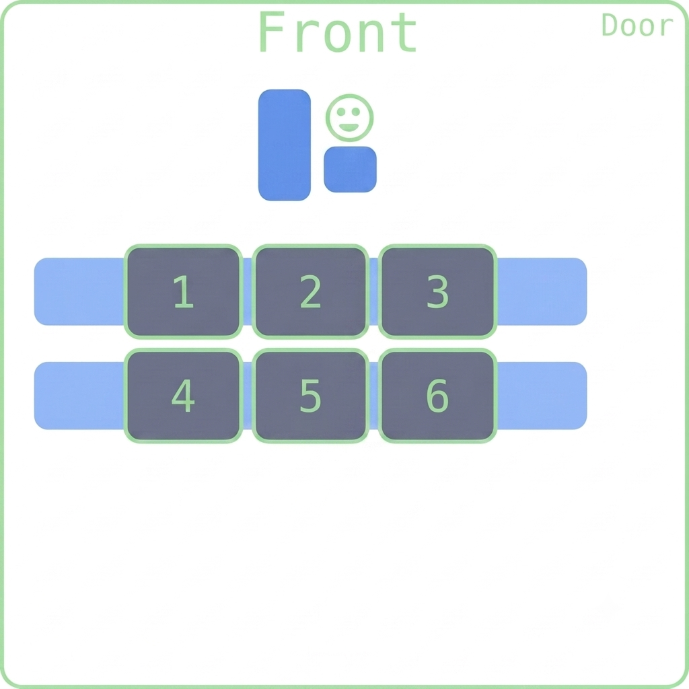

## Happy New Month and New Week! 

::::{style='font-size:.8em'}
- Class grouping today: Scan the QR code or go to [https://tools.jedrembold.prof/daily](https://tools.jedrembold.prof/daily)
- Class code is `GrtN9`
- Introduce yourselves! What class assignment do you inherit from last month?
::::

::::::cols

::::col
{width=60%}
::::
::::col
{width=60%}
::::
::::::

---


## Quick Announcements
:::{.sml style="font-size: 43px;"}
- Project __ImageShop__ is due today at 10:00pm
- Second midterm exam is ***this Friday 6th of November in this class!***. 
	- Exactly the same format as it was in Midterm 1 exam
	- Written in Canvas 
	- Partially opened (Remember the definition of partially opened)
		- No programming in any development environment such as VS Code
		- You can look up your past assignments on GitHub or in your note but not from the VS code
		- You ***CANNOT*** Google or use any AI and/or any GenAI tools 
	- Remember you MUST share your entire screen from the proctoring tool during exams 
		- You are being watched!
- Focused on Chapters 4-6, and 8 (Graphics, Functions, Interactive Programs, and Lists)
    - Practice questions will be posted by tomorrow 
	- No problem set this week: just studying for exam
:::

---


## Inheritance: Reuse and Extend
:::{.sml style="font-size: 45px;"}
- **Inheritance** lets a new class reuse and specialize the behavior of an existing class.
- The existing class is the **parent** (or base); the new class is the **child** (or subclass).
- A child gets the parent's methods and attributes, and can add its own.

```python
class Employee:
	def __init__(self, name):
		self.name = name

	def introduce(self):
		return f"Hi, I'm {self.name}."

class Manager(Employee):
	def approve_request(self):
		return f"{self.name} approved the request."

manager = Manager("Sam")
print(manager.introduce())
print(manager.approve_request())
```
:::

::: notes
Ask students which class defines `introduce` and which class defines `approve_request`.
:::

---

## A Child Can Specialize Behavior
:::{.sml style="font-size: 45px;"}
- A subclass can define a method with the same name as a parent method.
- This is **overriding**: calling that method on a child uses the child's version.

```python
class Employee:
	def describe_role(self):
		return "I work at the company."

class Manager(Employee):
	def describe_role(self):
		return "I manage a team."

worker = Employee()
manager = Manager()
print(worker.describe_role())
print(manager.describe_role())
```
:::

::: notes
Before showing the output, have students predict which implementation each call uses.
:::

---

## `super()` Calls Parent Behavior
:::{.sml style="font-size: 45px;"}
- `super()` gives a subclass access to methods from its parent class.
- Use `super().__init__(...)` to initialize the parent's attributes instead of repeating that code.
- The child can then add its own attributes.

```python
class Employee:
	def __init__(self, name):
		self.name = name

class Manager(Employee):
	def __init__(self, name, team_size):
		super().__init__(name)
		self.team_size = team_size

manager = Manager("Sam", 4)
print(manager.name, manager.team_size)
```
:::

---

## Extend Parent Method with `super()`
:::{.sml style="font-size: 44px;"}
- An override can keep the parent's behavior and build on it.
- Call `super().method_name(...)` from the child's method.

```python
class Employee:
	def describe_role(self):
		return f"{self.name} works at the company."

class Manager(Employee):
	def __init__(self, name, team_size):
		super().__init__(name)
		self.team_size = team_size

	def describe_role(self):
		description = super().describe_role()
		return f"{description} They lead {self.team_size} people."

manager = Manager("Sam", 4)
print(manager.describe_role())
```
:::

---

## Guided Practice: A More Specific Pet
:::{.sml style="font-size: 40px;"}
- Start with a `Pet` class that stores a name and has a `speak` method.
- Create a `Dog` subclass that uses `super()` to initialize the name.
- Override `speak` so a dog says `Woof!`.
- **Predict:** What will `print(dog.name, dog.speak())` display?

```python
class Pet:
	def __init__(self, name):
		self.name = name

	def speak(self):
		return "..."

class Dog(Pet):
	def __init__(self, name):
		super().__init__(name)

	def speak(self):
		return "Woof!"

dog = Dog("Milo")
print(dog.name, dog.speak())
```
:::

::: notes
Expected output: Milo Woof! Point out that `Dog` inherits `name` setup and overrides only `speak`.
:::

---

## Group Problems LO's
- Define a class that inherits from another
- Override parent methods in a child class
- Properly use `super()` in a child constructor

---

## Inherit Last week's BankAccount:
- A `BankAccount` has an owner and a balance.
- Add a `SavingsAccount` that reuse the parent's setup, add an interest rate, and report its account type.
- **Try it:** Implement `describe()` in the child by extending the parent's description with `super()`.

<!-- ```python
class BankAccount:
	def __init__(self, owner, balance):
		self.owner = owner
		self.balance = balance

	def describe(self):
		return f"{self.owner}: balance ${self.balance:.2f}"

class SavingsAccount(BankAccount):
	def __init__(self, owner, balance, interest_rate):
		super().__init__(owner, balance)
		self.interest_rate = interest_rate

	def describe(self):
		# Complete: reuse the parent description and add the rate.
		return f"{super().describe()}, rate {self.interest_rate:.1%}"

account = SavingsAccount("Ari", 250, 0.03)
print(account.describe())
```

::: notes
Expected output: Ari: balance $250.00, rate 3.0%. Ask why calling `super().__init__` avoids duplicated initialization.
::: -->

---


## Problem 1a: I'm on a Boat!
- Grab the starter codes from the ***Discord***
- This is a coding problem. Work in pairs on a single computer, and discuss your algorithm **BEFORE YOU WRITE ANY CODE**. 
- I have provided to you already a `Vehicle` class, which tracks several attributes and includes an initial `__repr__` method
- Your task:
	- Create a new `Boat` class that inherits from `Vehicle`
	- Its constructor should only accept a weight, as the terrain type should always be set to `"water"`
	- Override its `__repr__` method to correctly print out command needed to create the new boat objects. So it should return something like `"Boat(5000)"`, if 5000 was the weight.

---

## Problem 1b: I'm on a really big boat!
- Swap who is typing!
- Now define a `Carrier` class that inherits from boat
- A carrier has two new attributes to track:
	- A `capacity` (integer) which should be provided when a carrier is created
	- An `onboard` list which tracks what planes are currently onboard. It always starts empty when the carrier is created.
- Override its `__repr__` method to correctly print out command needed to create the new Carrier objects. So it should return something like `"Carrier(8000, 3)"`, if 8000 was the weight, and it had a capacity for 3 planes

---

## Problem 1c: Insert Plane Here
- Swap who is typing!
- Add a method to the `Carrier` class of `add_plane`, which accepts a plane's weight as an argument
	- If the number of planes currently on the carrier is less than its capacity, then add the weight to the onboard list and increase the carriers own weight by that amount
	- Otherwise, just print `"Deck full!"`
