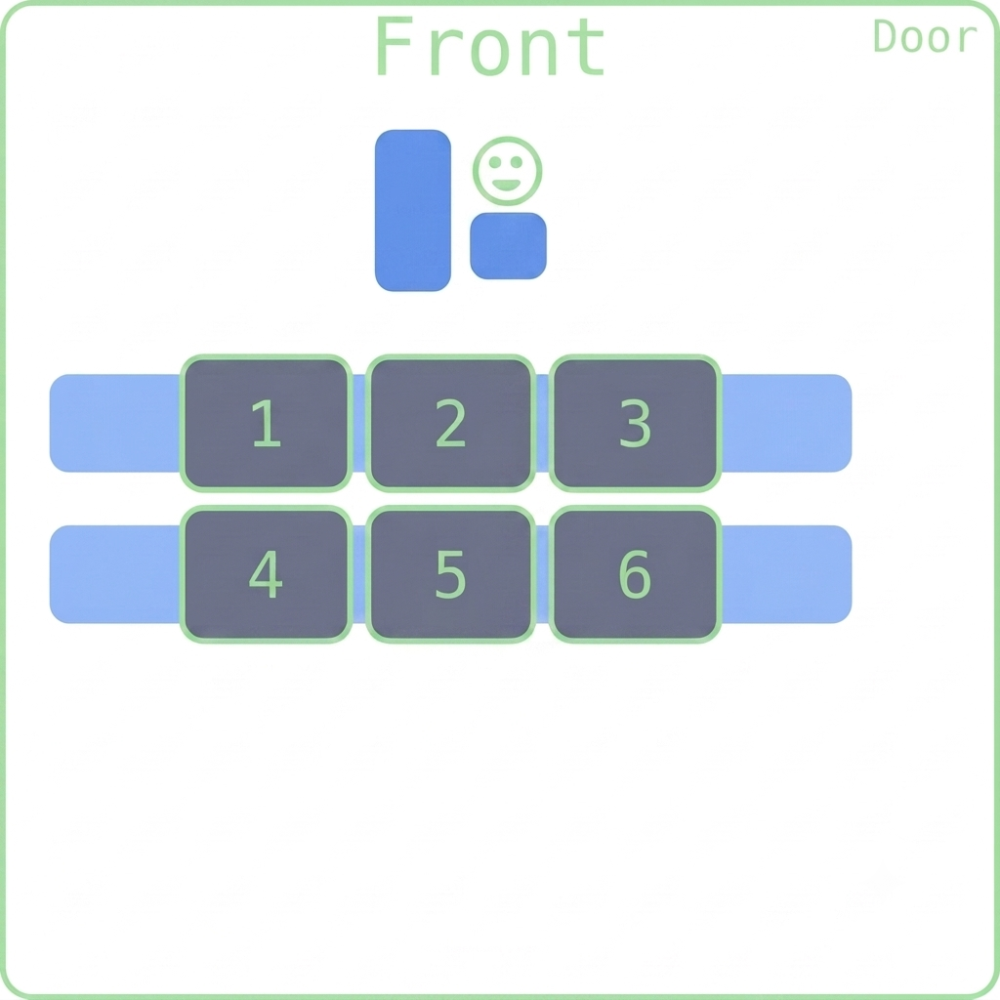

## Happy Wednesday! 

::::{style='font-size:.8em'}
- Class grouping today: Scan the QR code or go to [https://tools.jedrembold.prof/daily](https://tools.jedrembold.prof/daily)
- Class code is `GrtN9`
- Introduce yourselves! What class assignment do you inherit from last month?
::::

::::::cols

::::col
{width=60%}
::::
::::col
{width=60%}
::::
::::::

---


## Quick Announcements
:::{.sml style="font-size: 43px;"}
- Second midterm exam is ***this Friday 6th of November in this class!***. 
	- Exactly the same format as it was in Midterm 1 exam
	Remember all the information about the Dos and Don'ts highlighted on Monday
	<!-- - Written in Canvas 
	- Partially opened (Remember the definition of partially opened)
		- No programming in any development environment such as VS Code
		- You can look up your past assignments on GitHub or in your note but not from the VS code
		- You ***CANNOT*** Google or use any AI and/or any GenAI tools 
	- Remember you MUST share your entire screen from the proctoring tool during exams 
		- You are being watched! -->
- Focused on Chapters 4-6, and 8 (Graphics, Functions, Interactive Programs, and Lists)
    - Practice questions 1 & 2 were posted, study them!
		- Solution to practice question 1 is posted, while solution to practice question 2 will be release tomorrow  
	- Section meeting this week will be devoted to prepping for the exam.
:::

---

## Maps and Dictionaries
- A common form of information associates pairs of data values
	- Commonly called a _map_ in computer science
	- Python calls such a structure a _dictionary_
- A dictionary associates two different values:
	- A simple value called the _key_, which is often a string but doesn't need to be
	- A larger and more complex object called the _value_
- This idea of associating pairs of values is exhibited all over in the real world
	- Actual dictionaries! The words are the keys, the definitions the values.
	- Web addresses! Keys are the urls, the values are the webpage contents.

---

## Creating Dictionaries
- Python dictionaries use squiggly brackets ```{}``` to enclose their contents
- Can create an empty dictionary by providing no key-value pairs:
```python
empty_dict = {}
```
- If creating a dictionary with key-value pairs
	- Keys are separated from values with a colon ```:```
	- Pairs are separated by a comma ```,```
```python
generic_dict = {'Bob': 21, 0: False, 13: 'Thirteen'}
```
---

## Keys and Values
:::{.sml style="font-size: 44px;"}
- The value of a key-value pair can be **any** Python object, mutable or immutable
	- This includes other dictionaries!
- The key is more restricted:
	- Must be immutable
		- Dictionaries or lists cannot work as a key
		- Tuples can, though!
	- Must be unique per dictionary
:::
<!-- 

		::::::cols
		::::col
		**Viable**
		```python
		A = {True: 'Seth', False: 'Jesse'}
		B = {'Jill': 13, 'Jack': 12}
		C = {(1, 2): {'x': 1}}
		```
		::::
		::::col
		**Illegal**
		```python
		# X = {{'x': 1, 'y': 2}: 'Shark'}
		Y = {[1, 3, 5]: 'Odd'}
		Z = {'A': 13, 'B': 24, 'A': 15}
		```
		::::
		:::::: -->


---

## Selection
- The fundamental operation on dictionaries is selection, which is still indicated with square brackets: `[]`
- Dictionaries are **unordered**, so a numeric index does not go inside the brackets
- Use the key directly to select its corresponding value:
```python
>>> A = {'Jack': 12, 'Jill': 13}
>>> A['Jack']
12
>>> B = {True: 13, 0: 'Why?'}
>>> B[0]
'Why?'
```
---

## Losing Your Keys
- If you attempt to index a key that doesn't exist, you will get an error:
```python
A = {'Jack': 12, 'Jill': 13}
print(A['Jil'])
```
- If in doubt, check for the presence of a key with the `in` operator:
```python
if 'Jil' in A:
		print(A['Jil'])
```

---

## Rewriting the Dictionary
- Dictionaries are *mutable*!
	- We can add new key-value pairs
	- We can change the value associated with a key
	```python
	>>> d = {}
	>>> d['A'] = 10
	>>> d['B'] = 12
	>>> print(d)
	{'A': 10, 'B': 12}
	>>> d['A'] = d['B']
	>>> print(d)
	{'A': 12, 'B': 12}
	```

<!-- 
---

## Grade Sheet Example
- Suppose we had a file of student IDs and accompanying scores that we wanted to read into a dictionary and then access.
```python
def read_to_dict(filename):
		dictionary = {}
		with open(filename) as f:
				for line in f:
						ID, score = line.strip().split(',')
						dictionary[ID] = score
		return dictionary

def get_student_score():
		scores = read_to_dict('SampleGrades.txt')
		done = False
		while not done:
				student_id = input('Enter a student id number: ')
				if student_id == "":
						done = True
				elif student_id in scores:
						print(f"Student got a {scores[student_id]}.")
				else:
						print(f"Student id {student_id} was not found in classlist")
```

---

 ## Understanding Check
What is the printed value of the code below?
```python
A = [
		{'name': 'Jill',  'weight': 125, 'height': 62},
		{'name': 'Sam',   'height': 68},
		{'name': 'Bobby', 'height': 72},
]
A.append({'weight': 204, 'height': 70, 'name': 'Jim'})
B = A[1]
B['weight'] = 167
print([d['weight'] for d in A if 'weight' in d])
```
- `[100, 204]`
- `[156, 173, 204]`
- `[100, 167, 173, 204]`
- `[125, 167, 204]`

--- -->

## Iterating through a Dictionary
- Frequently we might want to iterate through a dictionary, checking either its values or its keys
- Python supports iteration with the `for` statement:
```python
for key in dictionary:
		value = dictionary[key]
		# Code to work with that key and value
```
- You can also use the `.items()` method to get keys and values together
	- Returns an iterable of tuples containing each key-value pair
```python
for key, value in dictionary.items():
		# Code to work with that key and value
```

---

## Finding Students by Grade
:::{.sml style="font-size: 44px;"}
```python
def get_students_with_score():
		scores = read_to_dict('SampleGrades.txt')
		done = False
		while not done:
				des_grade = input('Enter a letter grade: ')
				if des_grade == "":
						done = True
				else:
						for st_id, grade in scores.items():
								if grade == des_grade.strip().upper():
										print(f"{st_id} got a {grade}")
```
:::

---

## Common Dictionary Methods
:::{.sml style="font-size: 44px;"}
| Method call | Description |
| --- | --- |
| `len(dict)` | Returns the number of key-value pairs in the dictionary. |
| `dict.get(key, value)` | Returns the value associated with `key`. If the key is not found, returns the specified value, which is `None` by default. |
| `dict.pop(key)` | Removes the key-value pair corresponding to `key` and returns the associated value. Raises an error if the key is not found. |
| `dict.clear()` | Removes all key-value pairs, leaving the dictionary empty. |
| `dict.items()` | Returns an iterable that cycles through tuples consisting of a key-value pair. |
:::

---

## Dictionary Records
- While most commonly used to indicate mappings, dictionaries are also used to store records
- For example:

```python
boss = {
		'name': 'Scrooge',
		'title': 'founder',
		'salary': 1000
}
```
- Allows easy access to attributes without worrying about ordering:
	```python
	print(boss['name'])
	```
---

## Group Problems LO's
- How to define a dictionary in Python
- How to utilize common dictionary operations and methods
- Reading in and parsing data from a file

---

## Problem 1: Tracing Definitions
What is the printed value of the below code?
```python
A = [
	{'name': 'Jill',  'weight':125, 'height':62},
	{'name': 'Sam',   'height':68},
	{'name': 'Bobby', 'height':72},
]
A.append({'weight':204, 'height':70, 'name':'Jim'})
B= A[1]
B['weight'] = 167
print([d['weight'] for d in A if 'weight' in d])
```


<div class='cols'>
<div class='col poll'>
<ol>
	<li> `[100,204]`</li>
	<li>`[156,173,204]`</li>
	</ol>
</div>
<div class='col poll'>
<ol style='counter-reset: li 2'>
	<li> `[100,167,173,204]` </li>
	<li>`[125,167,204]` </li>
</ol>
</div>
</div>

---

## Problem 2a: Parsing Pairs
- Grab the starter codes from ***Discord***
- This is a coding problem. Work in pairs on a single computer, and discuss your algorithm **BEFORE YOU WRITE ANY CODE**.
- The file `grades.txt` has student names (first and last), then a comma, and then their current grade in a class
- Your task is to write a function to read in the data from the file and populate a dictionary with the names being the keys and the grades the corresponding values.

---

## Problem 2b: Grade Lookup
- Swap who is typing!
- Write a function called `get_student_grade` which prompts the user for a student's name and then prints out that student's grade.
- If the typed student does not exist, just print out "Student does not exist"

---

## Problem 2c: Grade Reporting
- Swap who is typing!
- Write another function `get_students_with_grade` which prompts the user to type in a desired grade.
- Then all the names of students who received that grade should be printed to the screen
- Bonus: Also return all the names as elements of a list

---

## Demo 
- `Tweets.csv` contains tweet data from users
- Our task is to see what hashtags are trending or most popular
