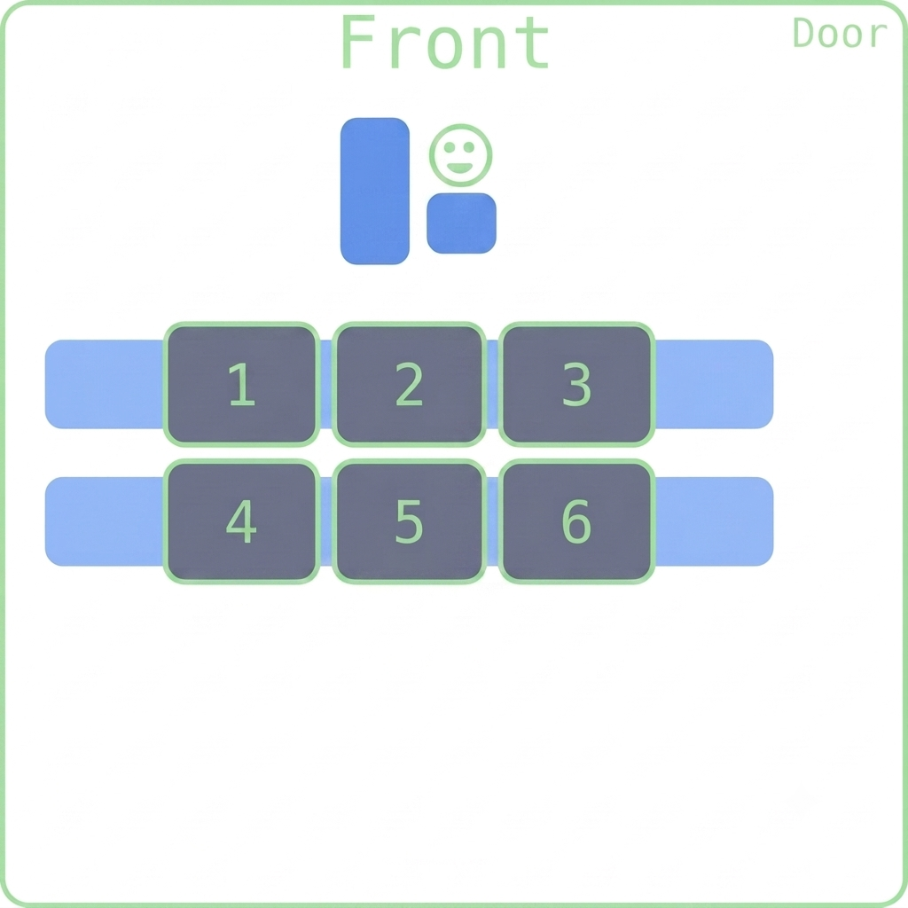
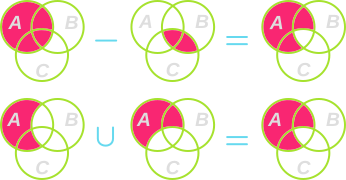

## Happy New Week! 

::::{style='font-size:.8em'}
- Class grouping today: Scan the QR code or go to [https://tools.jedrembold.prof/daily](https://tools.jedrembold.prof/daily)
- Class code is `Wk12N`
- Introduce yourselves! What class assignment do you inherit from last month?
::::

::::::cols

::::col
{width=60%}
::::
::::col
{width=60%}
::::
::::::

---


## Quick Announcements
:::{.sml style="font-size: 43px;"}
- Project ***Enigma*** will be published tomorrow and introduced on Wednesday
- You are invited to attend TechByte tomorrow __November 10 at 12pm in Smullin B17__:
	- I will be talking on ***The future of software engineering***
- Prof Jed Rembold will be visiting and teaching on Friday this week and Monday next week
	- Prof Agbo will be a way for a conference.

:::

---

## Mathematical Sets
- A _set_ is an unordered collection of **distinct** values.
	- **digits** =  0, 1, 2, 3, 4, 5, 6, 7, 8, 9 
	- **evens** =  0, 2, 4, 6, 8 
	- **odds** =  1, 3, 5, 7, 9 
	- **primes** =  2, 3, 5, 7 
	- **squares** =  0, 1, 4, 9 
	- **primary** =  red, green, blue 
	- **$\mathbf{R}$** =  x where x is a real number 
	- **$\mathbf{Z}$** =  x where x is an integer 
	- **$\mathbf{N}$** =  x where x is an integer >=0 
- The set with no elements is call the _empty set_ (∅)

---

## Pythonic Sets
- Enclosed within squiggly brackets
- No key-value pairs, just single values separated by commas
```python
digits = { 0, 1, 2, 3, 4, 6, 7, 8, 9 }
squares = { 0, 1, 4, 9 }
primary = { "red", "green", "blue" }
```
- Set elements must be immutable
- Sets themselves are generally mutable
- Can **not** create an empty set just using `{ }`!
	- Python assumes this to be an empty dictionary!
	- Must instead use `set()`.

---

## Set Operations
- The fundamental set operation is _membership_ (∈)
	- 3 ∈ **primes**
	- 3 ∉ **evens**
	- red ∈ **primary**
	- -1 ∉ **N**
- The _union_ of the sets $A$ and $B$ ($A \cup B$) consists of all elements in either $A$ or $B$ or both.
- The _intersection_ of the sets $A$ and $B$ ($A \cap B$) consists of all elements in both $A$ and $B$.
- The _set difference_ of $A$ and $B$ ($A - B$) consists of all elements in $A$ but not in $B$.
- The _symmetric set difference_ of $A$ and $B$ ($A\triangle B$) consists of all elements in $A$ or $B$ but not in both.

---

## Python Implementations
- Python's built-in implementation of sets supports all these same operations
- Can either use appropriately named methods on sets or operators between sets
- Membership
	`3 in primes`{.inlinecode}

:::{.cols}
::::{.col}
- Union:
	`A.union(B)`{.inlinecode}
	`A | B`{.inlinecode .python}
- Intersection
	`A.intersection(B)`{.inlinecode}
	`A & B`{.inlinecode .python}
::::

::::{.col}
- Difference
	`A.difference(B)`{.inlinecode}
	`A - B`{.inlinecode .python}
- Symmetric difference
	`A.symmetric_difference(B)`{.inlinecode}
	`A ^ B`{.inlinecode .python}
::::
:::

---

## Venn Diagrams
:::{.sml style="font-size: 44px;"}
- A _Venn Diagram_ is a graphical representation of a set which indicates common elements as overlapping areas
- The following Venn diagrams illustrate the effect of the 4 primary set operations

::::::cols
::::col

<br>


::::

::::col

<br>


::::
::::::
:::

---

## Set Relationships
- Sets $A$ and $B$ are _equal_ ($A = B$) if they have the same elements.
	- This would make them the same circles in a Venn diagram
- Set $A$ is a _subset_ of $B$ ($A\subseteq B$) if all the elements in $A$ are also in $B$.
	- This would mean that the circle for $A$ would be entirely inside (or equal) to the circle of $B$
- Set $A$ is a _proper subset_ of $B$ ($A\subset B$) if $A$ is a subset of $B$ and the two sets are not equal

---

## Informal Proofs
- You can use Venn diagrams to justify different set identities
- Example: Say you wanted to show that:
$$ A - (B \cap C) = (A-B) \cup (A-C)$$



---

## Python Set Methods
- Can also use "set comprehension" to generate a set
	`{ x for x in range(0,100,2) }`{.inlinecode}

 Function | Description
---|------
`len(set)` | Returns the number of elements in a set
`elem in set` | Returns `True` if `elem` is in the set
`set.copy()` | Creates and returns a shallow copy of the set
`set.add(elem)` | Adds the specified `elem` to the set
`set.remove(elem)` | Removes the element from the set, raising a `ValueError` if it is missing
`set.discard(elem)` | Removes the element from the set, doing nothing if it is missing

---

## Why use sets?

Sets come up naturally in many situations
: Many real-world applications involve unordered collections of unique elements, for which sets are the natural model.

Sets have a well-established mathematical foundation
: If you can frame your application in terms of sets, you can rely on the various mathematical properties that apply to sets.

Sets can make it easier to reason about your program
: One of the advantages of mathematical abstraction is that using it often makes it easy to think clearly and rigorously about what your program does.

Many important algorithms are described in terms of sets
: If you look at websites that describe some of the most important algorithms in computer science, many of them base those descriptions in terms of set operations.

---

## Representing Data
:::{.sml style="font-size: 44px;"}
- To use computation effectively, we frequently need to be able to represent real world data in a way that computers can easily work with
	- Real world data is often more complicated or nuanced than just "a list of numbers"
- Python's existing data structures are **tools**, which you can use to help represent certain ideas
	- _Lists_ when you have sequential type data, wherein there is a logical ordering to the data in question (where position matters)
		- Example: GPA over the course of 4 years
	- _Tuples_ or _classes_ when you have elements that should be grouped together but which have no inherent ordering. Generally use tuples for simple records and write custom classes for more complex. Could potentially also use a dictionary.
		- Example: Student names in a class
	- _Maps_ or _dictionaries_ when you have specific keys corresponding to other values.
		- Example: Student grades
:::

---

## Tricky Data
- Human readable data is not always the best machine readable data!

Name | Class | Q1 | Mid | Q3 | Final
---|---|---|---|---|---
Sally | Python | A | B | B | A
Jake | Python | B | B | B | C
James | Astro | B | B | A |
Lily | Astro | A | A | B |
Ben | Python | C | B | B | A

- Storing the above in a 2D array would work, but would be frustrating to work with

---

## A Computer Friendly Approach
- Student grades are time ordered, so we could use a list for the grades
- Each student has a corresponding sequence of grades (and students are unordered), so we could use a dictionary where student names are the keys and the list of grades the values
- Each class corresponds to an unordered set of students. Could have another dictionary where the keys were the class names and the values were the dictionary of students/grades

---

## Example Representation
```{.python style='max-height:900px'}
{
	"Python": {
		"Sally": ["A", "B", "B", "A"],
		"Jake": ["B", "B", "B", "C"],
		"Ben": ["C", "B", "B", "A"]
	},
	"Astro": {
		"James": ["B", "B", "A"],
		"Lily": ["A", "A", "B"]
	}
}
```
---

## Compound Structure Storage
- Structures representing complicated data can often be large enough that you don't want to store them within your program itself
- We can put them in their own file, but reading them in with our current tools would be complicated
	- Current methods read in text, so we would need to then _parse_ the text to identify what data structures we needed to create and what elements we needed to add
	- This is certainly possible, but is sometimes more overhead than what we would like
- It can be useful then to store the data structure in a file in such a format that can be easily read into Python

---

## Group Problems Daily LO's
- What is a set, and how do we create them in Python?
- How can we use set methods to manipulate and create new sets?
- In what situations might using a set be most useful?


## Problem 1A: Set Tracing
:::{.sml style="font-size: 44px;"}
If we have the following sets from earlier:

------
**digits** = { 0, 1, 2, 3, 4, 5, 6, 7, 8, 9 }
**evens** = { 0, 2, 4, 6, 8 }
**odds** = { 1, 3, 5, 7, 9 }
**primes** = { 2, 3, 5, 7 }
**squares** = { 0, 1, 4, 9 }
------

What is the value of each of the following:

- evens ∪ squares
- odds ∩ primes
- primes - evens
- odds ∆ squares
:::


<!-- ## Understanding Check
Looking at the same sets:

----
**digits** = { 0, 1, 2, 3, 4, 5, 6, 7, 8, 9 }
**evens** = { 0, 2, 4, 6, 8 }
**odds** = { 1, 3, 5, 7, 9 }
**primes** = { 2, 3, 5, 7 }
**squares** = { 0, 1, 4, 9 }
----

What is the set resulting from:
$$ (\text{primes} \cap \text{evens}) \cup (\text{odds}\cap\text{squares})$$

:::{.hpoll}
#. ∅
#. { 1, 2, 9 }
#. { 1, 3, 4, 5}
#. { 0, 3, 4, 5, 7}
:::

--- -->

## Problem 1B: Set Tracing
::::::cols
::::col
Looking at the same sets:

----
**evens** = { 0, 2, 4, 6, 8 }
**odds** = { 1, 3, 5, 7, 9 }
**primes** = { 2, 3, 5, 7 }
**squares** = { 0, 1, 4, 9 }
----

::::

::::{.col style="flex-grow:1.5"}
What is the set `C` resulting from:
```python
A = primes.intersection(evens)
B = odds.intersection(squares)
C = A.union(B)
```

::::
::::::

:::{.hpoll}
#. ∅
#. { 1, 2, 9 }
#. { 1, 3, 4, 5}
#. { 0, 3, 4, 5, 7}
:::

---

## Problem 2a: Unique Characters
- This is a coding problem. Work in pairs or trios on a single computer, and discuss your algorithm **BEFORE YOU WRITE ANY CODE**.
- The file `artemisII.txt` contains a clip from a news article describing today's hopeful Artemis II launch to send astronauts back around the Moon.
- Your task is to read it into Python and then determine how many unique characters are represented in the text.
- There are absolutely ways to do this without using sets, but try to use them!
	- You can convert a string to a set by just saying `set(string)`

---

## Problem 2b: Pangrams
- Swap who is typing!
- A pangram is a word or piece of text that contains every letter of the English alphabet
- Is this block of text a pangram?
- Again, try to use set operations or methods to answer this question. Though you could always check yourself with other methods.
- You probably want to handle the capitalization issue somehow!

---

## Problem 2c: The Extra Letters
- Swap who is typing!
- Which other characters are present in the text that are not alphabetical characters?
	- Again, there are other ways you have to do this, but think about how to use sets
- Print them to the screen as a single string.

<!-- ---

# Demo
## Qwerty vs Dvorak
- I use the Dvorak keyboard layout, where the letters on the home row are: `"AOEUIDHTNS"`
- What fraction of words in the English library can I type with purely those letters, and how does it compare to the classic Qwerty home row of `"ASDFGHJKL"`?
- Solve with both looping and set approaches. Which is runs faster? -->
