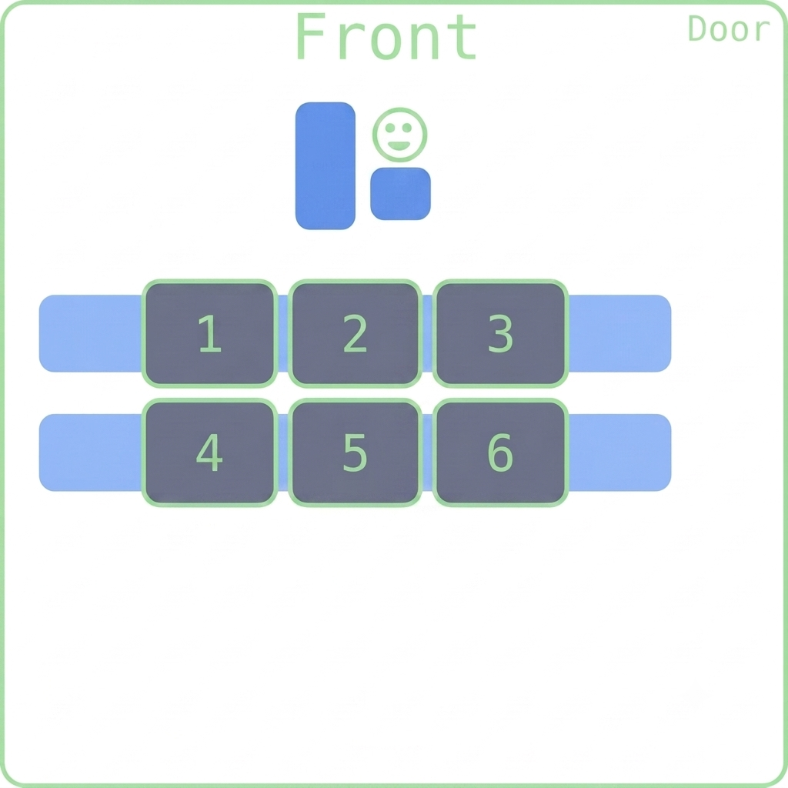

## Happy Wednesday! 

<!-- ::::{style='font-size:.8em'}
- Class grouping today: Scan the QR code or go to [https://tools.jedrembold.prof/daily](https://tools.jedrembold.prof/daily)
- Class code is `Wk12N`
- Introduce yourselves! Have you ever encrypted any information before? How did you do it?
::::

::::::cols

::::col
{width=60%}
::::
::::col
{width=60%}
::::
::::::

--- -->

## Quick Announcements
:::{.sml style="font-size: 43px;"}
- I will be working on grading the midterm 2 and publishing it early next week
- Project ***Enigma*** guide went out yesterday and due on ***Monday November 23***
	- You essentially have **more than a week** for this one. Use the time wisely!
	- We will introduce the project in the class today ...
	- Prof Jed Rembold will teach on Friday and Monday next week.
		- Hopefully, Jed will demonstrate with you how to visualize Enigma problem
	- Section meeting this week will also be dealing with things related to the Enigma problem

:::

---

## Visual Simulation (Jed's class)
- How are the parts of an Enigma machine connected?
- How do the rotors work, and how does changing a rotor change the wiring connections?
- How can we encrypt and decrypt messages with an Enigma Machine?

<!-- ---

## Building the Machine
- To get us going, we are going to construct simple paper versions of the Enigma Machine!
	- All groups should have 1-2 templates
- Cut out the 4 "parts", and carefully tape them as indicated to create a tube and three rings
- The rings should be able to fit around the tube, but should fit snuggly

---

## Fixed Rotors
- Slide the rotors onto the tube so that they are in ascending numerical order from left to right
- Position all rotors so that the left "A" line aligns with the tube "A" line
	- We'll call this the AAA rotor position
- Now, **DO NOT SHIFT THE ROTORS**
- One cool attribute about the Enigma machine is that it is symmetric: you use it the same way for both encryption and decryption.
- Decrypt my secret message to you: `EBUMJUF`

---

## Rotating Rotors
:::{style='font-size:.9em'}
- In practice though, the fast rotor moves up one position _before_ each signal is passed through
- Decided on a starting rotor configuration, making them all different
	- So each rotor should start with a different left letter on the bold "A" line
	- Write it down!
- Now, decide on a one-word message you want to encrypt. Make it at least 5 letters!
- Work out and write down what the encrypted message would be
- Keep in mind that:
	- Rotors advance _up_ the alphabet (so turn away from you) **before** you trace the signal through
	- If one rotor moves from Z back to A, you also need to advance the rotor to the left of that rotor by one
:::

---

## The Great Decryption!
- I'm going to collect and redistribute all the secret messages
- Given the starting rotor positions and the message, can you decrypt the message?

--- -->

## Walkthrough the Milestones (Fred)
## Project 4 Milestones
:::{style="font-size:.9em;"}

- Project 4 has slightly more milestones than past projects, but each is still meant to give you a testable aspect of the program that you can bite off one piece at a time
	- Milestone 0: Activate the keyboard when pressed
	- Milestone 1: Connect the keys directly to the lamps (no encryption)
	- Milestone 2: Design and implement rotors
	- Milestone 3: Implement one stage in the encryption (through 1 rotor)
	- Milestone 4: Implement the full encryption path
	- Milestone 5: Make the rotors advance properly each key press
- Web examples exist for helping you test each step of the process, linked [here](https://willamette.edu/~esroberts/roberts-enigma/Milestones/) and in the guide.

:::

---

## {data-background-iframe="https://willamette.edu/~esroberts/roberts-enigma/Milestones/"}

---

## Model-Controller-View
::::cols
:::col
- The Enigma project is designed using the common _model, controller, view_ paradigm
- Breaks an interactive program up into 3 pieces:
	- The controller: the piece that deals with user input
	- The view: the piece that handles graphical output
	- The model: the piece that controls what should be happening at any given time
:::
:::col
\begin{tikzpicture}%%width=100%
[
every node/.style={circle, draw, minimum size=2cm, ultra thick, Green},
]
\node (model) at (0,0) {Model};
\node[below right = of model](view) {View};
\node[below left = of model](cont) {Controller};
\path[latex-latex, ultra thick, Blue] (model) edge (view)
				   (model) edge (cont)
				   (view) edge (cont);
\end{tikzpicture}
:::
::::

---

## Modeling
- In the Enigma project, the view and the controller are handled for you
	- Both are actually handled in the same module
	- Both export various methods that you can use to get input or interact with them from within the model
- You are responsible for writing the code that comprises the model
- There is also a constants module, where all of the various constants that you may need are stored

---

## Extras!

---

## {data-background-iframe="https://enigma.virtualcolossus.co.uk/VirtualEnigma/index.htm"}

<!-- ## Enigma Rotors {data-state="RotorDemo"}

<canvas contenteditable="true" width="1485" height="810" style="border: none; overflow: hidden; outline-width: 0px; width: 1485px; height: 810px;"></canvas>

<td style="text-align:center;">
    <table class="CTControlStrip">
        <tbody style="border:none;">
            <tr>
                <td>
                    
                </td>
                <td>
                    
                </td>
            </tr>
        </tbody>
    </table>
</td> -->

