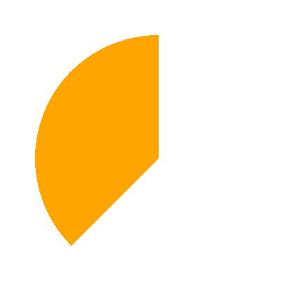
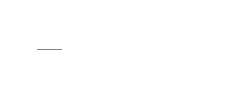
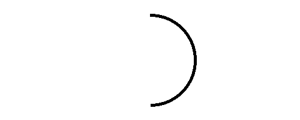

## Happy Week 8!
- No group activity today!
<!-- ::::{style='font-size:.8em'}
- Class grouping today: Scan the QR code or go to [https://tools.jedrembold.prof/daily](https://tools.jedrembold.prof/daily)
- Class code is `HUsTv1`
- Introduce yourselves! What is your favorite art animation?
::::

::::::cols

::::col
{width=60%}
::::
::::col
{width=60%}
::::
:::::: -->

---

## Quick Announcements
- Welcome from the long weekend
- Problem Set 4 is __due today at 10 pm__ 
- Project Breakout is posted and due next week Monday
- Project Wordle grading is underway.
- Attend your session meeting for more help and tools needed to succeed on the project.
- Answer this short poll [here](https://www.polleverywhere.com/agbofred203). Use ONLY your initials or an anonymous name.

---

## Review
- Recall the Animation Problem last week Wednesday?


---

## Problem 2: The Setup
- This is a coding problem, work in pairs or trios on a single computer
- In `SquareFun.py`, I've drawn an initial box for you
- Your task is cause the square to move horizontally across the screen such that it takes _exactly_ 5 seconds to cross entirely

---

## Problem 2b: The Growth
- Switch who is typing!
- Now, we want the box to also increase in size as it moves across the screen
- **Until** it reaches a size of 100 pixels, then it stops growing (but keeps moving)


<!-- ## Problem 2c: Symmetric Growth
- Switch who is typing!
- The box grows from the top left corner atm, which looks weird
- Add logic to also adjust the position of the box so that it seems to grow from the center

--- -->

## Problem 2c: Target Time!
- Switch who is typing!
- I've provided you a function that "throws a dart" to a specified position
- Add a timeout so that the dart is thrown when it would strike the center of the box

---

## Problem 2d: Moving the Dart
- Switch who is typing!
- Even if the dart hits the box, the box moves out from under it currently, which looks weird
- Add logic so that the dart is moved along with the box once it hits the board
- This will likely require accessing the same dart object in _multiple_ callback functions, one of which assigns it. How can you manage this?

---

## Complex Graphics: GArcs

::::::cols
::::{.col style='font-size:.9em'}
<!--- Up until now, we haven't had a way to draw an arc!-->
- The `GArc` class represents an arc formed by taking a section of the perimeter of an oval.
- 3 things necessary:
	- The bounding rectangle geometry (upper left corner and width and height)
	- The _starting angle_ (in degrees)
	- The _sweep angle_ (in degrees) which is how far the arc extends
- Negative angles move in the clockwise direction
::::

::::col

\begin{tikzpicture}%%width=100%
\draw[MPurple] (-2,0) -- (2,0) (0,-2) -- (0,2);
\draw[dashed, MBlue] (-1.5,-1.5) rectangle (1.5, 1.5);
\draw[ultra thick, MRed, line cap=round] (45:1.5) arc (45:270:1.5);

\draw[MOrange, dashed] (0,0) -- (45:1.5);
\draw[MOrange, thick, -stealth] (0:1) arc (0:45:1) node[midway,right,font=\scriptsize\sf] {start};

\draw[MGreen, thick, -stealth] (45:0.5) arc (45:270:0.5) node[midway, left, font=\scriptsize\sf] {sweep};
\end{tikzpicture}

::::
::::::

---

## Fillable Arcs
- The `GArc` class is a `GFillableObject`, and so you can call `.set_filled()` on a `GArc` object
- Filled like a pie-shaped wedge formed between the center of the bounding box and the starting and end points of the arc

::::::cols
::::col
```python
def filled_arc():
    gw = GWindow(400, 400)
    arc = GArc(50, 50, 
			   350, 350, 
			   90, 135)
    arc.set_color("orange")
    arc.set_filled(True)
    gw.add(arc)
```
::::

::::col
{width=50%}
::::
::::::


<!-- Moving to a lab?
## Pacman Discussion
::::::cols
::::col
How to recreate the animation below? Each group has a question to answer on the right.
<br><br><br>

{width=100%}
::::
::::{.col style="flex-grow:1.5;"}


Group A
: How could we create the initial PacMan image?

Group B
: How can we move PacMan and bounce him off the edges?

Group C
: How can we make his mouth open and close?

Group D
: How can we make his mouth flip around when he bounces off the walls?


::::

::::::
-->


## The `GPolygon` class
- Used to represent graphical objects bounded by line segments
	- Polygons consist of several _vertices_ bounded by _edges_

{width=20%}

- Location not fixed in upper left, but at some convenient reference point
- Often a convenient reference point is near the center of the object, but it doesn't need to be
- `GPolygon`s are `GFillableObject`s, so they can be filled

---

## Polygonal Construction
- The `GPolygon` function creates an **empty** polygon, to which you then can add vertexes
- Can create a vertex by calling `.add_vertex(x,y)` on the `GPolygon` object
	- `x` and `y` measured **relative to the reference point**
- Vertexes past the first can be defined in a few ways:
	- `.add_vertex(x,y)` adds another new vertex relative to the reference point
	- `.add_edge(dx,dy)` adds a new vertex relative to the preceding vertex
	- `.add_polar_edge(r, theta)` adds a new vertex relative to the previous using polar coordinates

---

## Triangle By Vertex
```{.python style='max-height:800px;'}
def triangle_by_vertex():
    def create_triangle(b, h):
        tri = GPolygon()
        tri.add_vertex(-b / 2, h / 2)
        tri.add_vertex(b / 2, h / 2)
        tri.add_vertex(0, -h / 2)
        return tri

    gw = GWindow(500, 500)
    triangle = create_triangle(200, 200)
    triangle.set_filled(True)
    triangle.set_color("red")
    gw.add(triangle, 250, 250)
```

---

## Triangle by Polar Edge
```{.python style='max-height:800px;'}
def triangle_by_polar_edge():
    def create_eq_triangle(side):
        tri = GPolygon()
        tri.add_vertex(0, 0)
        for i in range(0, 360, 120):
            tri.add_polar_edge(side, i)
        return tri

    gw = GWindow(500, 500)
    triangle = create_eq_triangle(100)
    triangle.set_filled(True)
    triangle.set_color("green")
    gw.add(triangle, 250, 250)
```

---

## Compound Objects
- The `GCompound` class makes it possible to combine several graphical objects so that the entire structure behaves as a single object
- Can be thought of as a combination of `GWindow` and `GObject`
	- You can add objects to it, but then you can also add it (and everything in it) to a window as a single unit
- Uses its own coordinate system relative to a reference point
	- When adding objects to the `GCompound`, you place them relative to the reference point
	- When adding the `GCompound` to a canvas, you set the location of the reference point

---

## And my Axe!
```{.python style='max-height:800px;'}
def my_axe():
    def create_axe():
        axe = GCompound()
        shaft = GRect(-15, 0, 30, 300)
        shaft.set_filled(True)
        shaft.set_color("brown")
        axe.add(shaft)

        blade = GPolygon()
        blade.add_vertex(0, 0)
        blade.add_vertex(200, -50)
        blade.add_vertex(200, 50)
        blade.set_filled(True)
        blade.set_color("gray")
        axe.add(blade, -80, 50)
        return axe

    gw = GWindow(500, 500)
    axe = create_axe()
    gw.add(axe, 250, 100)
```


---

## Problem 1: Tracing Understanding
::::::cols
::::col
Which of the below blocks of code will create the image to the right? The window measures 500 x 200 pixels and the value of `d` is 150.
::::

::::col
{width=65%}
::::
::::::

::::::cols
::::col

:::{.block name="A"}
```{.python style='font-size:.8em; margin-left:1em;'}
x, y = 250 - d / 2, 100 - d / 2
a1 = GArc(x, y, d, d, 90, -180)
gw.add(a1)
```
:::

:::{.block name="C"}
```{.python style='font-size:.8em; margin-left:1em;'}
x, y = 250 - d, 100 - d
a1 = GArc(x, y, d, d, -180, 90)
gw.add(a1)
```
:::

::::

::::col
:::{.block name="B"}
```{.python style='font-size:.8em; margin-left:1em;'}
x, y = 250 - d / 2, 100 - d / 2
a1 = GArc(x, y, d, d, 90, 180)
gw.add(a1)
```
:::

:::{.block name="D"}
```{.python style='font-size:.8em; margin-left:1em;'}
x, y = 250 - d / 2, 100 - d / 2
a1 = GArc(x, y, d, 180, -90)
gw.add(a1)
```
:::

::::
::::::


<!-- ---

## Problem 2: An Arrowhead
- This is a coding problem, work in pairs or trios on a single computer
- In `arrow.py`, I've drawn the initial shaft of an arrow for you (you are welcome)
- Your task is to add an arrow head to the right end of the arrow, which should look as shown below:


---

## Problem 2b: The Fletchings
- Switch who is typing!
- No arrow will fly straight without its fletchings. Now add two parallelograms on the left end of the arrow.


- Mimic the dimensions and angles as closely as possible!

---

## Problem 2c: The Flight
- Switch who is typing!
- Up until this point, everything has just been added to the GWindow
- Change that, creating a `GCompound` and add everything to that instead
- Add the `GCompound` to the left edge of the window, and animate it flying to the right
- BONUS: stop the animation when the tip of the arrow hits the right side of the screen


---

## Time It!
::::::{.cols style="align-items: center"}
::::{.col style="font-size:.9em; flex-grow: 1.5"}
- Suppose we wanted to make a stopwatch
- Let's aim for a narrow diamond for the hand
- Circle around outside, with red arc between 12 and 2 to indicate "almost done"
- Hand initially points towards current mouse position
- When we click, it instead starts animating, rotating towards 12, where it stops

::::

::::col

::::
::::::

 -->

---

## Project 2: Breakout!

::::::{.cols style='align-items:center'}
::::col
- Project 2 is recreating the classic arcade game ***Breakout***!
- Guide is posted [here](https://jrembold.github.io/Website_Backup/class_files/cs151/Projects/Project_Breakout/), and due by __Monday March 10 at 10 PM__
- Start early to have more time to learn and try out things! 
::::

::::col

<iframe width='100%' height='400vh' src="https://www.youtube.com/embed/UhAEjDKEHgk" title="Data Driven Gamer: Breakout (Atari, 1976 arcade, 60fps)" frameborder="0" allow="accelerometer; autoplay; clipboard-write; encrypted-media; gyroscope; picture-in-picture" allowfullscreen></iframe>
<iframe width="100%" height="400vh" src="https://www.youtube.com/embed/QrlIqaN4ltM" title="DX Ball 2 gameplay (PC Game, 1999)" frameborder="0" allow="accelerometer; autoplay; clipboard-write; encrypted-media; gyroscope; picture-in-picture" allowfullscreen></iframe>
::::
::::::

---

## Breakout History
> - The popular Breakout arcade game was released by Atari in 1976
> - Atari founder Nolan Bushnell wanted a new game that would build on the success of the earlier game Pong. He assigned Steve Jobs to develop the game, promising a bonus if the game required a small number of chips.
> - As Wikipedia tells the story, "Jobs had little specialized knowledge of circuit board design but knew [his friend Steve] Wozniak was capable of producing designs with a small number of chips. He convinced Wozniak to work with him, promising to split the fee evenly between them."
> - Wozniak completed the game design in four days, but Jobs never told him about the bonus offer. Jobs was paid $\$5,000$, but Wozniak received only $\$350$.
> - Jobs and Wozniak co-founded Apple Computer the following year, which has grown to be the largest corporation in the world by market capitalization.

---

## Breakout Basics
::::::{.cols style='align-items: center'}
::::{.col style='font-size:.9em'}
- Breakout is a game in which the player attempts to break all the colored bricks by causing a bouncing ball to collide with them
- The player controls a paddle at the bottom of the screen which the ball will bounce off
    - The paddle can only move left and right
- If the ball makes it past the paddle to the bottom of the screen, the player loses a life
    - Lose 3 lives and it is game over!
::::

::::col

{width=50%}

::::
::::::

---

## Breakout Milestones
- Breakout is broken up over 5 milestones
- You have already seen or written pieces of similar code to many of the milestones!
    - Milestone 1: PS4 brick pyramid
    - Milestone 3: Section bouncy ball problem (this week)

<!--
## Other Milestones 
[Check the desciption here](https://agbofred.github.io/Spring_2024/Lecture/projects/Breakout_guide/Project_Breakout.html)
-->

---

## Milestones

<iframe width='60%' height='800px' src="https://willamette.edu/~esroberts/cs151/Assignments/Project2/Breakout1/index.html"></iframe>


<!-- ## Milestone 2

<iframe width='60%' height='800px' src="https://willamette.edu/~esroberts/cs151/Assignments/Project2/Breakout2/index.html"></iframe>


## Milestone 3

<iframe width='60%' height='800px' src="https://willamette.edu/~esroberts/cs151/Assignments/Project2/Breakout3/index.html"></iframe>


## Milestone 4

<iframe width='60%' height='800px' src="https://willamette.edu/~esroberts/cs151/Assignments/Project2/Breakout4/index.html"></iframe>


## Milestone 5

<iframe width='60%' height='800px' src="https://willamette.edu/~esroberts/cs151/Assignments/Project2/Breakout5/index.html"></iframe> -->

