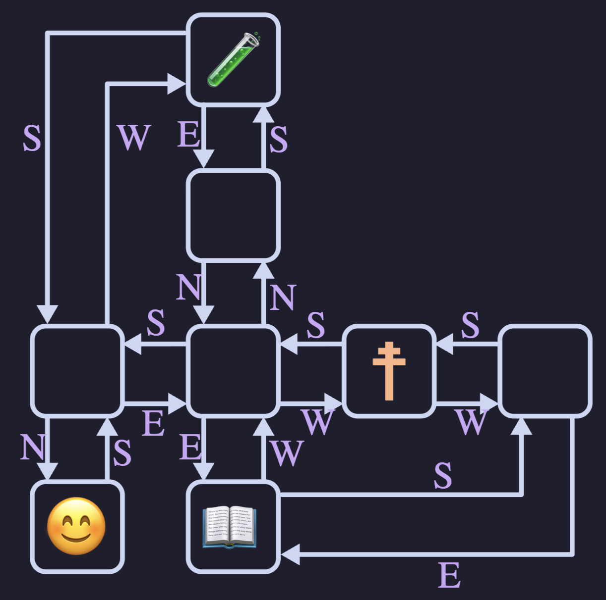

## Happy Wednesday 

::::{style='font-size:.8em'}
- Class grouping today: Scan the QR code or go to [https://tools.jedrembold.prof/daily](https://tools.jedrembold.prof/daily)
- Class code is `NyVK12`
- Introduce yourselves! When last did you change your address?
::::

::::::cols

::::col
{width=60%}
::::
::::col
{width=60%}
::::
::::::

---

## Quick Announcements
- Session leaders reported your Wordle scores and attendance record
  - Largely average performance
  - A few people have had the 3 max absenses from session already
    - For such people, each additional mising will take 5% from your total grade
- Project Breakout is due next week Monday
- I highly recommend you to attend the session meeting to receive practical help on the Breakout project.

--- 

## Mutants
- The most important difference between strings and lists is one of _mutability_
	- Strings we have already identified as being _immutable_: you can not change the individual elements
	- Lists, in contrast, are _mutable_, which means that we **can** change or assign new values to the elements of a list
- Immutable objects have many advantages in programming:
	- You don't have to worry about if the values will change
	- Immutable values can be more easily shared
	- Immutable objects are easier to use with concurrent programs
- In some situations though, mutable objects are the perfect tool for the job

---

## A Tutorial on Lists
::::::cols
::::col
- Thinking about mutable objects requires a shift in how we visualize our code interacting with the objects in memory
- [Link here](https://pythontutor.com/render.html#code=cool%20%3D%20%5B'blue',%20'violet'%5D%0Awarm%20%3D%20%5B'red',%20'orange'%5D%0A%0Acolors%20%3D%20%5Bcool,%20warm%5D%0Aother_colors%20%3D%20%5B%5B'blue',%20'violet'%5D,%0A%20%20%20%20%20%20%20%20%20%20%20%20%20%20%20%20%5B'red',%20'orange'%5D%5D%0A%0Aprint%28colors%20%3D%3D%20other_colors%29%0Aprint%28colors%20is%20other_colors%29%0A%0Acool%5B0%5D%20%3D%20'indigo'%0Awarm%20%3D%20%5B'orange',%20'yellow'%5D%0A%0Aprint%28colors%29%0Aprint%28other_colors%29&cumulative=false&curInstr=0&heapPrimitives=false&mode=display&origin=opt-frontend.js&py=3&rawInputLstJSON=%5B%5D&textReferences=false)
::::

::::{.col style="flex-grow:2;"}
```{.python style='max-height:900px; font-size:0.8em;'}
cool = ['blue', 'violet']
warm = ['red', 'orange']

colors = [cool, warm]
other_colors = [['blue', 'violet'],
				['red', 'orange']]

print(colors == other_colors)
print(colors is other_colors)

cool[0] = 'indigo'
warm = ['orange', 'yellow']

print(colors)
print(other_colors)
```
::::
::::::

---

## For Reference
- When working with mutable objects, it is better to think of the variable as holding a _reference_ to the object, rather than the actual contents of the object
- I find it useful to think of a reference as the "address" in memory where that object's contents can be found
- This undeniably complicates things, as referencing a mutable object lets you change it, which will immediately be reflected in anything _else_ that referenced that object
- Mutable objects can be terrific to work with, as their mutability makes them very flexible, but be wary of unexpected behavior

---

## Lists as Arguments
- When you pass a list as an argument to a function or return a list as a result, only the **reference** to the list is actually passed back and forth
- This means that the elements of the list are effectively shared between the function and the caller
	- Changes that the function makes to the elements **will** persist after the function returns
- Example of reversing a list in PythonTutor: [here](http://www.pythontutor.com/visualize.html#code=def%20reverse_in_place%28array%29%3A%0A%20%20%20%20for%20lh%20in%20range%28len%28array%29//2%29%3A%0A%20%20%20%20%20%20%20%20rh%20%3D%20len%28array%29%20-%20lh%20-%201%0A%20%20%20%20%20%20%20%20array%5Blh%5D,%20array%5Brh%5D%20%3D%20array%5Brh%5D,%20array%5Blh%5D%0A%0Aarray%20%3D%20%5B0,%201,%202,%203,%204,%205,%206,%207,%208,%209%5D%0Aprint%28f%22Forward%3A%20%7Barray%7D%22%29%0Areverse_in_place%28array%29%0Aprint%28f%22Reverse%3A%20%7Barray%7D%22%29&cumulative=false&curInstr=0&heapPrimitives=false&mode=display&origin=opt-frontend.js&py=3&rawInputLstJSON=%5B%5D&textReferences=false)

---

## Sneaky Mutability
- List's mutability can frequently be very nice to work with, but as with lists as arguments to functions, you need to be careful in some instances to ensure you understand how Python is treating the list
- One could encountered a few other problems where it can be easy to mess up:
	- Initializing a list to look like another list, wanting to make changes and then compare it to the original
		- [Example](http://www.pythontutor.com/visualize.html#code=A%20%3D%20%5B'Aardvark',%20'Butterfly',%20'Centipede'%5D%0AB%20%3D%20A%0A%0AB.append%28'Deer'%29%0AB.remove%28'Butterfly'%29%0A%0Aprint%28A%29%0Aprint%28B%29&cumulative=false&curInstr=0&heapPrimitives=false&mode=display&origin=opt-frontend.js&py=3&rawInputLstJSON=%5B%5D&textReferences=false)
	- Looping over a mutating list
		- [Example](http://www.pythontutor.com/visualize.html#code=A%20%3D%20%5B1,2,3,4,5,6,7,8,9%5D%0A%0Afor%20i%20in%20range%28len%28A%29%29%3A%0A%20%20%20%20print%28'Current%20index%3A%20%7B%7D,%20Current%20value%3A%20%7B%7D'.format%28i,A%5Bi%5D%29%29%0A%20%20%20%20if%203%20%3C%20A%5Bi%5D%20%3C%206%3A%0A%20%20%20%20%20%20%20%20A.remove%28A%5Bi%5D%29%0A%20%20%20%0Aprint%28A%29&cumulative=false&curInstr=0&heapPrimitives=false&mode=display&origin=opt-frontend.js&py=3&rawInputLstJSON=%5B%5D&textReferences=false)

---

## Cloning
- What can we do in these sorts of instances to not let mutability trip us up?
- _Clone_ the list instead of just assigning a reference
	- Creates a **new** object in memory
- Several ways you can make a shallow clone (in code)
	- Using the `.copy()` list method
	- Any slice always returns a new object
	- Using the `list()` function will return a new object

<!--
## Common Useful List Methods

Method | Description
---- | ------
`list.copy()` | Returns a new list whose elements are the same as the original
`list.append(value)` | Adds `value` to the end of the list
`list.insert(idx, val)` | Inserts `val` before the specified `idx`
`list.remove(value)` | Removes the first instance of `value` from the list, or errors
`list.reverse()` | Reverses the order of the elements in the list
`list.sort()` | Sorts the elements of the list. Can take an optional argument `key` to specify how to sort

## List functions on Iterators
- The `.sort` and `.reverse` methods reorder the list **in place** and do not return anything
- Commonly, you might want to loop through a list in a particular order, but not change the original list
- Python gives you two matching functions to do this, which return a **new** ordered version of the list, without changing the original
	- The `reversed()` function creates a new iterable object that returns its elements in the opposite order
	- The `sorted()` function creates a new iterable object that returns its elements in ascending order


## List building with loops
- Commonly will make lists with a simple:

	```python
	even_digits = [ 2, 4, 6, 8 ]
	```
- But in many cases, it is easier to specify the elements of a list using a sequence of values generated by a `for` loop. For instance

	```python
	even_digits = [ ]
	for i in range(0, 10, 2):
		even_digits.append(i)
	```
- Python gives us a shorthand notation to achieve this:

	```python
	even_digits = [ i for i in range(0, 10, 2) ]
	```
	- Called _list comprehension_

## Deleting elements from list
- Deleting an element from a list is possible with ```del``` statement
- However, in looping through the list:
	- attempt to delete an element while looping will result to IndexError
- One technique is to create a new list to store all desired element when looping

::::::cols
::::col
:::{.block name=NormalDelete}
- The code below will delete the 4th element in the list
```python
list1 =[2,4,6,5,3]
del list1[3]
print(list1)
```
:::
::::

::::col
:::{.block name=NewListTechnique .fragment}
- Code below create a new list of even num 
```python 
list1 = [2,4,6,5,3]
list2 =[] #to store ele
for i in range(len(list1)):
      if list1[i]%2==0: #remove odd
            list2.append(list1[i])
            
print(list1)
print(list2)
```
:::
::::
::::::


## Comprehending Lists
- The simplest list comprehension syntax is:
	
	```python
	[ expression iterator ]
	```
	where `expression` is any Python expression and `iterator` is a `for` loop header
- The iterator component can be followed by any number of additional modifiers
	- More `for` loop headers for nested loops
	- or `if` statements to select specific values
- Example: all even numbers to 20 not also visible by 3

	```python
	[i for i in range(0,20,2) if i % 3 != 0]
	```
-->


## Group Problems LO's
- Correctly trace code working with lists where mutability matters
- Work with and think about the id of mutable objects
- Practice interacting with the VSCode debugger

---

## Problem 1: Tracing Clues
What would the below code print out at the end?
```python
ballroom = ['Miss Scarlet', 'Mr. Green', 'Prof Plum']
hall = ['Mrs. Peacock', 'Col. Mustard']
study = ['Mrs. White']
house = [ballroom, hall, study]
hall = hall + study
for character in ballroom:
    if character[0] == 'P':
        house[1][0] = character
print(hall)
```

:::notes
Python actually has a special use of the `+=` for mutable objects, where it effectively does an extend() to update them IN PLACE. Who knew!?
:::

---

## Problem 2: The Escape
- Work in pairs on a single computer
- At the top of the lecture content `maze.py` file, enter in your pair/trios names
- The idea here is that you are plunged into a mysterious maze
- To cast the escape spell, you need to collect three items: a spellbook, potion, and wand
- The trick lies in finding them

---

## Problem 2: The Maze
::::::{.cols style="align-items: center"}
::::{.col style='font-size: .9em'}
- Each maze is generated custom for your group
- Consists of connected rooms, depicted with a special `MazeCell` object
- Each room has:
  - Some contents. Usually `None`, but sometimes one of the items you need!
  - A series of directions that _reference_ other connected rooms (or `None`)
::::

::::col


::::
::::::

---

## Problem 2: The Exploration
- To have a chance of finding your way out, it would help to work out the layout of your maze
- Can do so by utilizing VSCode's debugger!
- Place a breakpoint on the indicated line, and run the program in debug mode
- Now you can "explore" the `MazeCell`s by using the dropdown menu that appears
- Construct yourself a map!
  - What room connects to what? The memory address is unique here!
  - What item, if any, is in the room?

---

## Problem 3: Escaping!
- Given your map, construct a set of instructions that would take you from your starting position to gather all three needed items
- Express this series of instructions as a string of "NSEW" characters
- Enter it into `twisty` function when it is called at the bottom of the program, and then run the program normally. Did you escape?!

