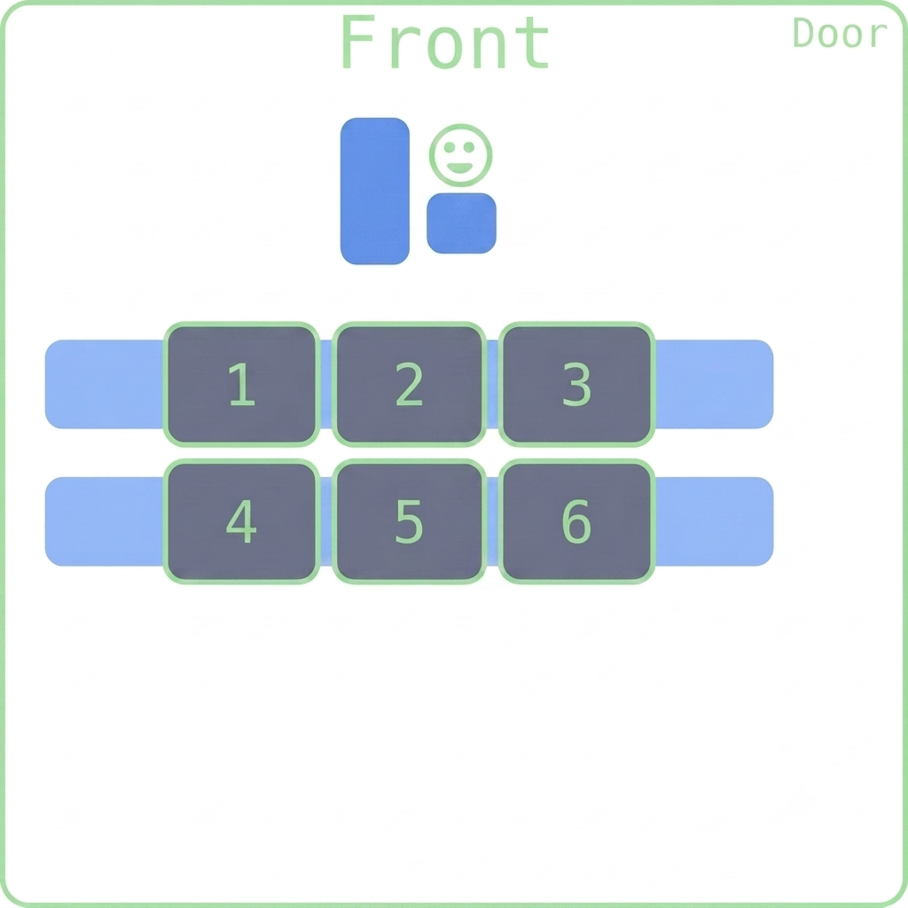

## Happy Week 9! 

::::{style='font-size:.8em'}
- Class grouping today: Scan the QR code or go to [https://tools.jedrembold.prof/daily](https://tools.jedrembold.prof/daily)
- Class code is `4BenGT`
- Introduce yourselves! Which list of things do you easily comprehend?
::::

::::::cols

::::col
{width=60%}
::::
::::col
{width=60%}
::::
::::::

---

## Quick Announcements
- Project Breakout is due today at 10:00pm
	- Update on Breakout Project downloaded starter files with no __run_journal.py__
		- Check the Discord announcement to download the file and include in your project.
- Problem set 5 will be published today and due next week Monday.

--- 

## Common Useful List Methods

Method | Description
---- | ------
`list.copy()` | Returns a new list whose elements are the same as the original
`list.append(value)` | Adds `value` to the end of the list
`list.insert(idx, val)` | Inserts `val` before the specified `idx`
`list.remove(value)` | Removes the first instance of `value` from the list, or errors
`list.reverse()` | Reverses the order of the elements in the list
`list.sort()` | Sorts the elements of the list. Can take an optional argument `key` to specify how to sort

---

## List functions on Iterators
- The `.sort` and `.reverse` methods reorder the list **in place** and do not return anything
- Commonly, you might want to loop through a list in a particular order, but not change the original list
- Python gives you two matching functions to do this, which return a **new** ordered version of the list, without changing the original
	- The `reversed()` function creates a new iterable object that returns its elements in the opposite order
	- The `sorted()` function creates a new iterable object that returns its elements in ascending order

---


## Deleting elements from list
- Deleting an element from a list is possible with ```del``` statement
- However, in looping through the list:
	- attempt to delete an element while looping will result to IndexError
- One technique is to create a new list to store all desired element when looping

::::::cols
::::col
:::{.block name=NormalDelete}
- The code below will delete the 4th element in the list
```python
list1 =[2,4,6,5,3]
del list1[3]
print(list1)
```
:::
::::

::::col
:::{.block name=NewListTechnique .fragment}
- Code below create a new list of even num 
```python 
list1 = [2,4,6,5,3]
list2 =[] #to store ele
for i in range(len(list1)):
      if list1[i]%2==0: #remove odd
            list2.append(list1[i])
            
print(list1)
print(list2)
```
:::
::::
::::::

---

## List building with loops
- Commonly will make lists with a simple:

	```python
	even_digits = [ 2, 4, 6, 8 ]
	```
- But in many cases, it is easier to specify the elements of a list using a sequence of values generated by a `for` loop. For instance

	```python
	even_digits = [ ]
	for i in range(0, 10, 2):
		even_digits.append(i)
	```
- Python gives us a shorthand notation to achieve this:

	```python
	even_digits = [ i for i in range(0, 10, 2) ]
	```
	- Called _list comprehension_

---

## Comprehending Lists
- The simplest list comprehension syntax is:
	
	```python
	[ expression iterator ]
	```
	where `expression` is any Python expression and `iterator` is a `for` loop header
- The iterator component can be followed by any number of additional modifiers
	- More `for` loop headers for nested loops
	- or `if` statements to select specific values
- Example: all even numbers to 20 not also visible by 3

	```python
	[i for i in range(0,20,2) if i % 3 != 0]
	```

---

## Group Problems LO's
- Correctly trace code with list methods and mutability considerations
- Work with common list methods
- Practice using lists to tabulate values

---

## Problem 1: Tracing Clues
::::::cols
::::col
Given the code to the right, what would be the printed value of `A`?


:::{.poll}
#. `['Fox', 'Giraffe', 'Hippo', 'Iguana']`
#. `['Fox', 'Hippo', 'Iguana']`
#. `['Iguana', 'Fox']`
#. None of the above
:::

::::

::::col
```{.python style="max-height:900px"}
A = [
	 'Fox',
	 'Giraffe', 
	 'Hippo'
	]
A.append('Iguana')
A[:].reverse()
B = A
for anim in B:
	if anim[1] == 'i':
		B.remove(anim)
print(A)
```
:::::
::::::

---


## Problem 2a: Some Cleaning
- This is a coding problem. Work in pairs or trios on a single computer
	- Discuss your algorithm **BEFORE YOU WRITE ANY CODE**. Make sure everyone understands.
- The file `raw_data.py` contains the constant `DATA`, which is a large list of strings
- Many of those strings are numbers, but some are not
- Your first task is to use a loop and `append` to create a list of only the entries that are numbers
- Your result should be a list of numbers, so you'll need to convert them from strings

---


## Problem 2b: Cleaning Comprehension
- Rewrite your above code to generate the exact same list, but using a list comprehension
- Should be able to compare the lists you got from each method, and they should have identical contents

---


## Problem 2c: Purging
- Both the previous approaches created a _new_ list in memory with the desired traits
- What if we wanted to prune the "bad" values out of the original list?
- Write an approach that would accomplish this, ensuring that the list `id` before your code and after you code is still the same!

---


## A Tabulation Aside
- Lists can also be useful when you have a collection of values and you need to count how many values fall into different "bins"
	- This is commonly called _tabulation_
- You could accomplish this with multiple counting variables, but it is unreasonable to define and track 50+ variables
	- With a list, the number at each index represents a count of something
	- Instead of creating 50+ variables, you just have a list of 50+ counts
- Useful if you can equate bins to indexes directly, but sometimes you just need to define what index corresponds to what category

---


## Problem 2d: Tabulation
- The cleaned data list contains number values ranging from 0 to 25
- Use tabulation to count how many times each number appears in the array
- What are the top three more frequently occurring numbers?

