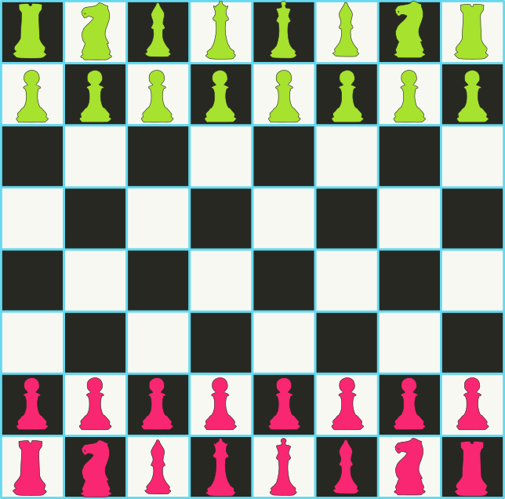
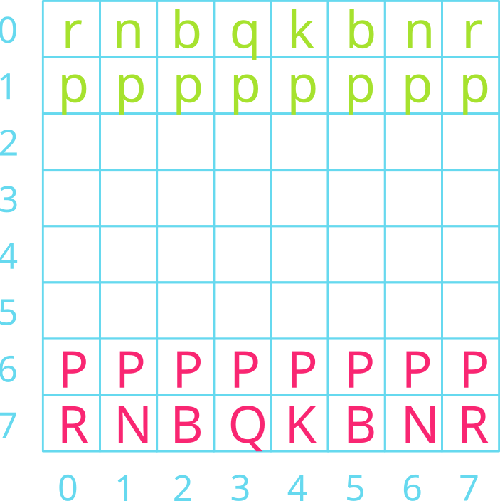
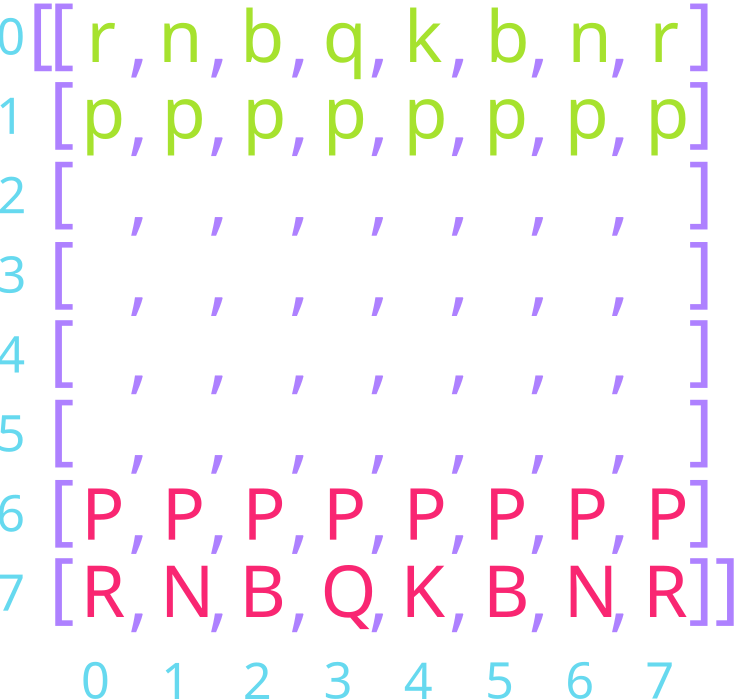
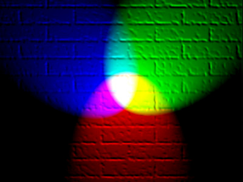
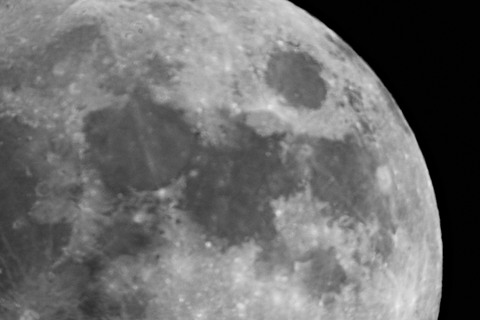

## Happy Week 9! 

::::{style='font-size:.8em'}
- Class grouping today: Scan the QR code or go to [https://tools.jedrembold.prof/daily](https://tools.jedrembold.prof/daily)
- Class code is `2DRGB`
- Introduce yourselves! What's the favorite color for your picture background?
::::

::::::cols

::::col
{width=60%}
::::
::::col
{width=60%}
::::
::::::

---

## Quick Announcements

- Problem set 5 (which is the last problem sets) is due next week Monday.
	- You should have all the tools you need for the homework today
- The deadline for courses withdrawal is Friday October 23 at 5pm.
	- Come to see me by tomorrow Thursday during office hours if you have concerns about your grade standing.

--- 

## Recall the List Data Cleaning Problem
- Open the same `Prob2.py` file from Monday's class 
- Complete the last tabulation task

---

## A Tabulation Aside
- Lists can also be useful when you have a collection of values and you need to count how many values fall into different "bins"
	- This is commonly called _tabulation_
- You could accomplish this with multiple counting variables, but it is unreasonable to define and track 50+ variables
	- With a list, the number at each index represents a count of something
	- Instead of creating 50+ variables, you just have a list of 50+ counts
- Useful if you can equate bins to indexes directly, but sometimes you just need to define what index corresponds to what category

---

## Problem 2d: Tabulation
- The cleaned data list contains number values ranging from 0 to 25
- Use tabulation to count how many times each number appears in the array
- What are the top three more frequently occurring numbers?

---

## Picturing Multidimensional Arrays
- Multidimensional arrays are commonly pictured as each inner list being stacked beneath the previous
- In such a representation, the outermost/first elements/indices represent the row, and the inner/second elements/indices represent the column

`[ [2, 9, 4], [7, 5, 3], [6, 1, 8] ]`{style="display: block; margin: auto; text-align: center;"}

<br>

\begin{tikzpicture}%%width=80%
[
block/.style = {draw, MGreen, outer sep=0pt, font=\Large, minimum size=1cm},
]
\node[block](00) at (0,0) {2};
\node[block,below=0 of 00](10) {7};
\node[block,below=0 of 10](20) {6};

\node[block,right=0 of 00](01) {9};
\node[block,right=0 of 10](11) {5};
\node[block,right=0 of 20](21) {1};

\node[block,right=0 of 01](02) {4};
\node[block,right=0 of 11](12) {3};
\node[block,right=0 of 21](22) {8};


\node[block,color=MBlue,font=\tt,](00) at (5,0) {magic[0][0]};
\node[block,color=MBlue,font=\tt,below=0 of 00](10) {magic[1][0]};
\node[block,color=MBlue,font=\tt,below=0 of 10](20) {magic[2][0]};

\node[block,color=MBlue,font=\tt,right=0 of 00](01) {magic[0][1]};
\node[block,color=MBlue,font=\tt,right=0 of 10](11) {magic[1][1]};
\node[block,color=MBlue,font=\tt,right=0 of 20](21) {magic[2][1]};

\node[block,color=MBlue,font=\tt,right=0 of 01](02) {magic[0][2]};
\node[block,color=MBlue,font=\tt,right=0 of 11](12) {magic[1][2]};
\node[block,color=MBlue,font=\tt,right=0 of 21](22) {magic[2][2]};
\end{tikzpicture}


## Initialize a Chessboard {data-transition="slide-in fade-out" data-transition-speed="slow"}
{data-id="test" data-auto-animate-easing=ease-out}

## Initialize a Chessboard{data-transition="fade-in fade-out" data-transition-speed="slow"}
{data-id="test"}

## Initialize a Chessboard{data-transition="fade-in slide-out" data-transition-speed="slow"}
{data-id="test"}


---

## The `GImage` Class
- You can display an image from a file in PGL using the `GImage` class.
`GImage(filename, x, y)`{.inlinecode}
	- `filename` is the string containing the name of the file which contains the image
	- `x` and `y` are the coordinates of the upper left corner of the image
- Best to use one of the common image formats
	- Graphical Interchange Format (GIF): `fish.gif`
	- Joint Photographic Experts Group (JPEG): `fish.jpg`
	- Portable Network Graphics (PNG): `fish.png`

<!--
---

 ## Images and Copyrights
- Most images that you might find on the web are protected by copyright under international law.
- Ensure you have the necessary permissions before using an image
	- On the web, the image hosting site will often specify what rules apply to that image
		- Example: Images from `www.nasa.gov` can be freely used as long as you add an attribution line
	- Non-commercial use of an image can sometimes fall under "fair use" doctrine, but academic integrity and common courtesy both demand you cite or acknowledge any material you have obtained from others.

--- -->

## Example: VLA Moonset
```{.python style='max-height: 800px; font-size:.7em;'}
from pgl import GImage, GWindow, GLabel

def image_example():
	gw = GWindow(800, 550)
	image = GImage("VLA_Moonset.jpg")
	image.scale(gw.get_width() / image.get_width())
	gw.add(image)

	citation = GLabel("Image Credit: Jeff Hellermann, NRAO / AUI / NSF")
	citation.set_font("15px 'Sans-Serif'")
	x = gw.get_width() - citation.get_width() - 10
	y = image.get_height() + citation.get_ascent()
	gw.add(citation, x, y)
```

---

## 2D Arrays → Images
- Image data is commonly stored in two-dimensional arrays
- Each element stores information about the pixel that exists at that location
- The `GImage` class lets you convert between the image itself and the array representing the image contents by using the `get_pixel_array` method, which returns a two-dimensional array of integers.
- We could get the pixels from our example image using:
  ```python
  image = GImage("VLA_Moonset.jpg")
  pixels = image.get_pixel_array()
  ```
- The first index of the pixel array gets you the row, the second index gets you the column

---

## Pixel Contents
:::{.sml style="font-size:45px;"}
- Each element in a pixel array is an integer in which the 32 bits are interpreted as:

\begin{tikzpicture}%%width=90%
[
box/.style={draw, very thick, outer sep=0pt}
]

\node[box, MPurple, text=white, font=\tt, label={[MPurple,font=\large\em]below:transparency}] (alpha) at (0,0) {1 1 1 1 1 1 1 1};
\node[box, MRed,  text=white, font=\tt, label={[MRed,font=\large\em]below: red}, right = 1mm of alpha] (red) {1 0 0 1 0 1 0 1};
\node[box, MGreen, text=white, font=\tt, label={[MGreen,font=\large\em]below: green}, right = 1mm of red] (green) {0 0 1 1 1 0 0 1};
\node[box, MBlue, text=white, font=\tt, label={[MBlue,font=\large\em]below: blue}, right = 1mm of green] (blue) {0 1 1 0 0 0 1 1};
\end{tikzpicture}

- The first byte (8 bits) is the transparency or alpha
- The next three bytes indicate the amount of red, green, and blue in the pixel, where each value varies from 0 to 255
	- Form the RGB of a color, generally expressed in hexadecimal form
		- `10010101` → `0x95`
		- `00111001` → `0x39`
		- `01100011` → `0x63`
	- Overall color: `#953963`{.no-highlight} or <svg width="100" height="50" style="display:inline-block; vertical-align:middle"><rect width="100" height="50" style="fill:#953963"></rect></svg>
:::

---

## Combining Light Colors

{width=60%}

---

## Transparency
- The first byte (8 bits) of the pixel value gives the transparency, which indicates how much of the background is allowed to show through
- Often denoted with the Greek letter alpha: $\alpha$
- Varies from 0 to 255 like the other 8 bit values:
	- 0 is entirely transparent
	- 255 is entirely opaque

---

## Breaking out the Colors
- You do not need to convert the pixel values yourself! PGL has built-in ways to extract the various colors

:::{style="font-size:.8em;"}

Function | Description
--- | -----
`GImage.get_red(pixel)` | Returns the integer (0-255) corresponding to the red portion of the pixel
`GImage.get_green(pixel)` | Returns the integer (0-255) corresponding to the green portion of the pixel
`GImage.get_blue(pixel)` | Returns the integer (0-255) corresponding to the blue portion of the pixel
`GImage.get_alpha(pixel)` | Returns the integer (0-255) corresponding to the alpha portion of the pixel
`GImage.create_rgb_pixel(r,g,b)` | Returns a 32-bit integer corresponding to the desired color

:::

---

## Image Thresholding
::::::cols
::::col
- As an example of reading and manipulating pixel values, lets look at how we could threshold the image to the right
- Thresholding is when you take a grayscale image and convert it to a black and white image, where a pixel is set to be white if it is above a certain threshold in brightness
- Grayscale, so each RGB component is the same
Let’s threshold at a value of 30
::::

::::col
{width=80%}
::::
::::::

<!--
---

 ## Image Thresholding Example 


```{.python style='min-height:980px; width=100%;'}

from pgl import GWindow, GOval, GImage

gw =GWindow(600,400)
image = GImage("Moon.png", 0,0)
image.scale(gw.get_width()/image.get_width())
gw.add(image)

def imagetreshold(e):
    TRESHOLD = 130
    pixel = image.get_pixel_array()
    #print(pixel)
    for r in range(len(pixel)):
        for c in range(len(pixel[0])):
            value = pixel[r][c]
            red =GImage.get_red(value)
            if red< TRESHOLD:
                pixel[r][c]= GImage.create_rgb_pixel(0,0,0)
            else:
                pixel[r][c] = GImage.create_rgb_pixel(255,255,255)
    # You must create a new Gimage
    new_image = GImage(pixel)
    gw.add(new_image)
gw.add_event_listener("click", imagetreshold)

```

--- -->

## Group Problems Daily LO's
- Recall of List comprehension
- Selecting from multidimensional arrays
- Creating pixel arrays from images
- Modifying pixel arrays

---

## Problem 1a: Comprehension! {data-notes="Solution: ',,,,'"}
What is the third element (index 2) in the below list?

`[i * 4 for i in "Oct 21, 2026" if not i.isalpha() and not i.isspace()]`{style="display: block; margin: auto; text-align: left; width: 2000px;"}

<br>

:::{.poll}
#. `21`
#. `",,,,"`
#. `"tttt"`
#. `"2222"`
:::

---

## Problem 1b: Comprehension
Suppose I construct the below 2D array using list comprehension:

`A = [[i+j for i in range(3)] for j in range(4)]`{.inlinecode .python}

What would be the output of:

`print([A[i][2] for i in range(len(A))])`{.inlinecode .python}

<br>

:::{.poll}
#. `[0,1,2]`
#. `[2,3,4]`
#. `[2,3,4,5]`
#. `[2,2,2,2]`
:::

---

## Problem 2a: That's No Moon
- Head into __Discord__ and grab the starter codes from there!
- This is a coding problem. Work in pairs on a single computer
	- Discuss your algorithm **BEFORE YOU WRITE ANY CODE**. Make sure everyone understands.
- You are working in `Prob2.py`
- Initial tasks:
	- Add a dark blue background rectangle to the window
	- Add a `GImage` of the `moon.png` image centered in the window

---

## Problem 2b: Odd Pixels
- Swap who is typing!
- Extract the pixel array from the moon image
- This moon image is a grayscale image, so the Red, Green, and Blue components are always equal
- Looping over all the pixels, how many pixels are darker than a value of 30?

:::notes
Should be 65760
:::

---

## Problem 2c: Thresholding
- Swap who is typing!
- Modify your last code to actually update the pixels in the array
	- If they are darker than 30, set them to a perfectly black pixel
	- Otherwise, set them to a perfectly white pixel
- Pass the updated pixel array into `GImage(pix_array)` and add the result to the window
- Play around with the thresholds to see different effects
- Since you are adding it on top of the original, you can also play around with giving the pixels some transparency (or making them different colors!)
