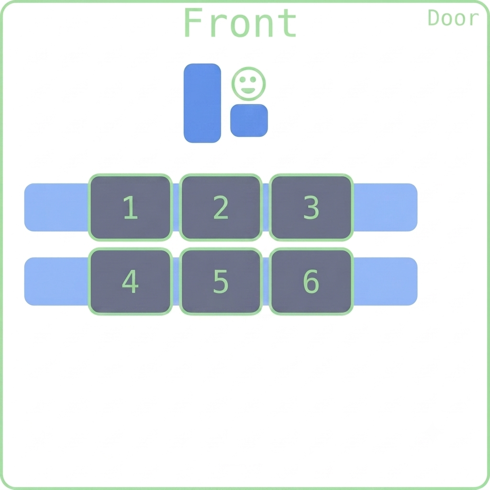

## Happy Monday! 

::::{style='font-size:.8em'}
- Class grouping today: Scan the QR code or go to [https://tools.jedrembold.prof/daily](https://tools.jedrembold.prof/daily)
- Class code is `SAg4L`
- Introduce yourselves! How long does it take your brain to add up all your siblings birthday?
::::

::::::cols

::::col
{width=60%}
::::
::::col
{width=60%}
::::
::::::

---


## Quick Announcements
:::{.sml style="font-size: 43px;"}
- I can imagine that you enjoyed some hands-on practice with ***JSON*** data structure in last two classes.
	- Professor Jed is an amazing teacher! 
- Project ***Enigma*** is due next week ***Monday November 23***
	- I do not expect people to ask for extension since we have plenty of time to complete it
- My sincere apologies for late feedback on the 2nd Midterm exam. I'll try to send them in by the weekend. 

:::

---


## Quick Info
:::{.sml style="font-size: 43px;"}
- We are currently in the Spring Course Registration Season
	- Consider registering ***CS-152: Data Structures***
		- Dig deeper into how to develop, measure, and evaluate efficient programs 
		- Counts towards the __CS Major__
		- Prereq: CS-151 - ***you are are eligible, consider registering it***

- Human Perception Research - by Ethan (Senior - CS Major)

:::

---

## Today's Class Plan

- Further discussion on searching algorithms?
- Linear Search
- Binary Search
- Jump Search
- Benchmarking: measuring algorithm efficiency

---

## What is Searching?

- **Goal:** find the position of a *target* value in a collection
- Return the **index** if found, otherwise `-1`
- The best algorithm depends on:
	- Is the data **sorted**?
	- How **large** is the data?
	- How often do we search?

---

## Linear Search

- Check each element, one by one, from the start
- Works on **unsorted** data

```python
def linear_search(data, target):
    for i in range(len(data)):
        if data[i] == target:
            return i
    return -1
```

---

## Linear Search: Simulation

Search for `7` in `[4, 2, 9, 7, 5, 1]`

```text
Step 1: [4] 2  9  7  5  1   4 != 7
Step 2:  4 [2] 9  7  5  1   2 != 7
Step 3:  4  2 [9] 7  5  1   9 != 7
Step 4:  4  2  9 [7] 5  1   7 == 7  -> return 3
```

- Best case: 1 comparison
- Worst case: `n` comparisons
- Time complexity: **O(n)** 
	- We will introduce the concept of ***Time Complexity*** more concretely later on

---

## Binary Search

- Requires **sorted** data
- Compare target to the **middle** element, discard half each step

```python
def binary_search(data, target):
    low, high = 0, len(data) - 1
    while low <= high:
        mid = (low + high) // 2
        if data[mid] == target:
            return mid
        elif data[mid] < target:
            low = mid + 1
        else:
            high = mid - 1
    return -1
```

---

## Binary Search: Simulation

Search for `23` in `[2, 5, 8, 12, 16, 23, 38, 56, 72, 91]`

```text
Step 1: low=0 high=9 mid=4 -> 16 < 23  -> low=5
Step 2: low=5 high=9 mid=7 -> 56 > 23  -> high=6
Step 3: low=5 high=6 mid=5 -> 23 == 23 -> return 5
```

- Only 3 comparisons instead of 6!
- Time complexity: **O(log n)**
- 1,000,000 items need at most ~20 comparisons

---

## Jump Search

- Requires **sorted** data
- Jump ahead in blocks of size `√n`, then do a linear search inside the block

```python
import math

def jump_search(data, target):
    n = len(data)
    step = int(math.sqrt(n))
    prev = 0
    while prev < n and data[min(prev + step, n) - 1] < target:
        prev += step
    for i in range(prev, min(prev + step, n)):
        if data[i] == target:
            return i
    return -1
```

---

## Jump Search: Simulation

Search for `56` in `[2, 5, 8, 12, 16, 23, 38, 56, 72, 91]` (n=10, step=3)

```text
Block 0-2: last = 8   < 56 -> jump
Block 3-5: last = 23  < 56 -> jump
Block 6-8: last = 72 >= 56 -> stop
Linear scan: 38 -> 56 found at index 7
```

- Time complexity: **O(√n)**
- Between linear and binary search
- Useful when jumping backward is costly

---

## Comparing the Algorithms

| Algorithm | Sorted needed? | Worst case |
|-----------|----------------|------------|
| Linear    | No             | O(n)       |
| Jump      | Yes            | O(√n)      |
| Binary    | Yes            | O(log n)   |

---

## What is Benchmarking?

- **Benchmarking:** measuring how long code takes to run on real inputs
- Complements theoretical (Big-O) analysis
- Useful for:
	- Comparing algorithms empirically
	- Seeing how runtime **scales** with input size
	- Revealing hardware and implementation effects
	- Deciding which algorithm to use in practice

---

## Benchmarking in Python

```python
import time

def benchmark(func, data, target, runs=100):
    start = time.perf_counter()
    for _ in range(runs):
        func(data, target)
    return (time.perf_counter() - start) / runs

for n in [1000, 10000, 100000, 1000000]:
    data = list(range(n))
    target = n - 1   # worst case
    print(n,
          benchmark(linear_search,target, data),
          benchmark(jump_search, target, data),
          benchmark(binary_search, target, data))
```

---

## Benchmarking Tips

- Use `time.perf_counter()` or the `timeit` module
- Repeat runs and **average** to reduce noise
- Test best, average, and worst cases
- Use the same data for every algorithm
<!-- - Sorting costs `O(n log n)`, so binary search pays off with **many** searches -->

---

<!-- ## Practice

1. Trace binary search for `8` in `[1, 3, 5, 8, 10, 12, 15]`
2. Count comparisons for linear vs. jump search for `91` in a 10-item list
3. Benchmark all three with `n = 10**6` and compare the results

--- -->

## Problem 1: Time It!
- Grab the starter codes from the ***Discord***
- This is a coding problem. Work in pairs on a single computer, and discuss your algorithm/approach _before_ you write any code!
- Write a function to benchmark the time it takes an arbitrary search function to run on a particular array and with a particular target
- You can use the `perf_counter()` function from the `time` library to get an arbitrary second count
  - Take two and subtract to get elapsed time
- Return the elapsed time

---

## Problem 2: Averaging Out
- Swap who is typing!
- If the target is near the start, we are likely to find it much faster
- It is better to randomly choose a bunch of targets, and then average over all the times
- Complete `compute_avg_time` to return the average benchmark time for 100 random targets
  - Randomly choose targets both inside and outside of the array!

---

## Problem 3: Multiple Arrays
- Swap who is typing!
- Ideally we want to see how our function _scales_, as the arrays get larger
- Complete `sweep_of_sizes` to compute the average benchmark for each size in the list
  - Choose a data type to return the results that include both the array size and the average time
    - You have several good options! Which do you prefer here?

---

## Problem 4: Table Display
::::::cols
::::{.col style='font-size:.8em'}
- Swap who is typing!
- Looking at the results in the data type you chose is not the nicest
- Complete `display_results` to print out a table of the computed output
- Add a third column for "Ratio", which is the current time divided by the previous time
- How does `jump_search` compare to our other algorithms?

::::

::::col
```{.text style='font-size:.8em'}
      N       Time (sec)  Ratio
          10    2.84e-07
         100    1.44e-06   5.06
       1,000    1.87e-05  13.00
      10,000    2.05e-04  10.99
     100,000    2.03e-03   9.91
   1,000,000    2.04e-02  10.02
  10,000,000    2.05e-01  10.04
```

::::
::::::

