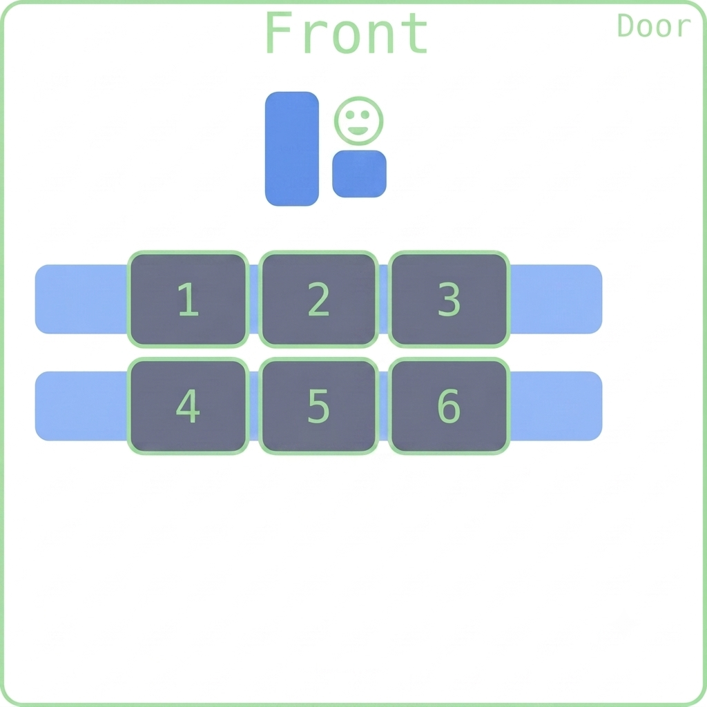

## Happy Wednesday! 

::::{style='font-size:.8em'}
- Class grouping today: Scan the QR code or go to [https://tools.jedrembold.prof/daily](https://tools.jedrembold.prof/daily)
- Class code is `DecK5`
- Introduce yourselves! How long does it take your brain to add up all your siblings birthday?
::::

::::::cols

::::col
{width=60%}
::::
::::col
{width=60%}
::::
::::::

---

## Quick Announcements
:::{style='font-size: 1em'}
- Midterm 2 results out 
- ImageShop project grade published
- All grade reports are out...
    - Reach out if there's any questions/concerns
- Enigma due on Monday night!
- Introducing the last project on Monday
  - NO VIDEO
:::

---

## Midterm 2 Debrief
::::::{.cols style='align-items:center'}
::::{.col style='flex-grow:1.5'}
\begin{tikzpicture}%%width=80%
  \begin{axis}[
      width=8cm,
      xlabel= Percent,
      ylabel= Number of Students,
      yticklabels={,,},
      ymajorticks=false,
      ylabel near ticks,
      color=white,
      ]
      \addplot [hist={density, bins=5, data min=40, data max=105}, fill=Orange] table[y=perc, col sep=comma] {../../data/Midterm2_Results_S2026.csv};
  \end{axis}
\end{tikzpicture}

::::

::::col
- Final breakdown:
    - Max: 101%
    - Average: 82.57%
    - Median: 79.5%
    - St Dev: 15.3%

::::
::::::

---

## Daily LO's
- How does selection sort operate?
- How can we get an idea for how an algorithm will scale just by looking at the code?
- What is Big-O notation?
- Can we identify examples of Big-O notation?

---

## Group Problem 1: Sort It!
- I am distributing small stacks of playing cards to each of your groups
- Designate:
  - The processor: the one pointing at the current card that is being looked at
  - The memory: the one whose left and right hands will mark the special positions
  - The counter: the one tallying how many cards have been looked at
- Shuffle the cards and deal out 5 in a row
  - Sort them according to selection sort, following your roles
  - How many cards did you look at? Does that agree with what you'd have thought?
- Shuffle all the cards back together and deal them all out.
  - Sort again. How many cards were looked at this time? Does this agree any better?

---

## Problem 2: Real-World O
- We are going to cycle through some real-world scenarios here
- For each, you'll have about 2 minutes to discuss with your group what Big-O scaling you think the process would involve

::: notes
NOTE (instructor only): Have groups commit to an answer and justify it in terms of how the work grows as the number of items grows. Reasoning matters more than the label.
:::

---

## Problem 2a: The Librarian
- Checking a shelf of books to see if any have a torn cover.

::: notes
NOTE (instructor only): Expected answer: O(N). Every book must be inspected, and in the worst case (no torn cover, or the torn one is last) you look at all of them. Double the books, double the work.
:::

---

## Problem 2b: The Mechanic
- Grabbing the largest wrench in a toolbox organized with molded slots for each tool.

::: notes
NOTE (instructor only): Expected answer: O(1). The molded slots mean the largest wrench's location is known in advance, so no searching is needed. Contrast with an unorganized toolbox, where finding the largest would be O(N). Organization of the data changes the scaling.
:::

---

## Problem 2c: Favorite Movies
- Finding 3 people in a class who all share the same favorite movie.

::: notes
NOTE (instructor only): Brute force (compare every triple) is O(N^3). Students may say O(N^2) if they compare pairs and then check a third. A smarter approach is to tally favorites in a dictionary and look for a count of 3, which is O(N). Use this to show that the algorithm choice matters, not just the problem.
:::

---

## Problem 2d: The Warehouse
- Retrieving a part from the bin labeled "Part #105" in a large, organized warehouse.

::: notes
NOTE (instructor only): Expected answer: O(1). Labeled, organized bins act like a dictionary or an index lookup: go directly to the bin regardless of warehouse size. Walking the aisles to find it would be O(N). Mention that walking time is not the point; the number of bins examined is.
:::

---

## Problem 2e: The Wedding Planner
- Creating a seating chart that ensures that no "mortal enemies" are seated together at the same table.

::: notes
NOTE (instructor only): Brute force tries every possible arrangement, which grows factorially (O(N!)) or at least exponentially. Accept "very bad / exponential" as a good answer. Note that verifying a given chart is cheap (about O(N^2) pairs at worst), but finding one is hard. Good teaser for intractable problems.
:::

---

## Problem 3: Algorithm Archaeology
- You have written a lot of code over the course of the semester!
- The following slide will have a handful of target "bounties"
- Your task is to fine examples of each bounty in code that you or someone in your group has written over the course of the semester.
- Be prepared to defend your choices to another group!

::: notes
NOTE (instructor only): Circulate and ask groups to explain their reasoning aloud. Emphasize that defending the choice, by counting how the operations scale, is the goal. Several answers may be valid.
:::

---

## Problem 3: The Bounties
- Find a snippet that looks like a single ***$O(N)$*** loop but is actually ***$O(N^2)$*** because of a built-in Python function.
- Find an ***$O(1)$*** operation
- Find an ***$O(N^2)$*** operation that does **not** use two nested for loops
- Find an ***$O(N)$*** operation that finishes in ***$O(1)$*** under special conditions
- Find the heaviest code you wrote this semester. How does it scale?

::: notes
NOTE (instructor only): Possible answers.
1) A loop containing `in` on a list, `.count()`, `.index()`, `.remove()`, `.insert(0, x)`, `list.pop(0)`, or string concatenation or slicing inside the loop.
2) Indexing a list, dictionary lookup, appending to a list, `len()`, or arithmetic.
3) Recursion with repeated work, a loop that calls a linear built-in such as `sum()` or `in` each iteration, or `sorted()` inside a loop.
4) A linear search that finds the item at the first position, an early `break` or `return`, or `any()`/`all()` short-circuiting.
5) Open-ended; look for nested loops, such as the Enigma plugboard or rotor code, or repeated searching. Ask students to state N.
:::

---

## Problem 4: Designing a Disaster
- This is a coding problem!
- Linear search is usually ***$O(N)$*** in the worst case situation.
- Design a searching algorithm that runs in ***$O(N^3)$***
  - It must still work! That is, it must still return a correct answer.

::: notes
NOTE (instructor only): Expected solution: three nested loops over the list, each running N times, with a body that does constant work. Inside, compare the element to the target, for example `for i in range(n): for j in range(n): for k in range(n): if data[k] == target: return k`. The result must still be correct, returning the index or -1. Watch for solutions that are only O(N^2) or that return early and are no longer worst-case N^3. Also watch for solutions that are wrong. Discuss why nobody would do this on purpose, and how accidental inefficiency can sneak in.
:::

