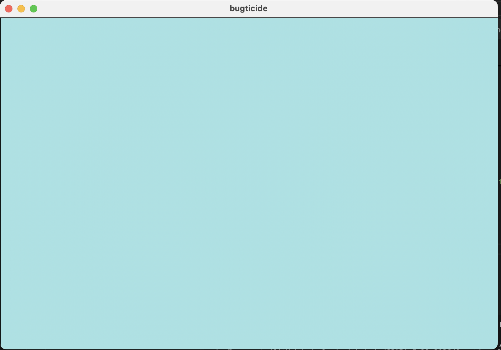
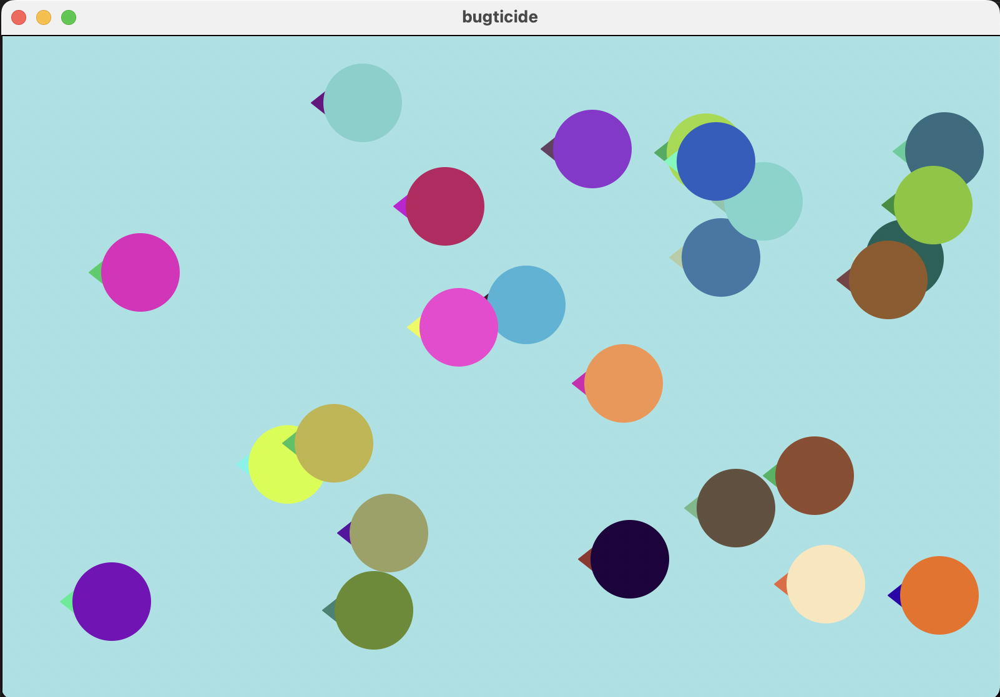

<!-- 
This second midterm exam contains 1 question that consists of topics already covered in the class (Functions, Graphics, and Interactive Programs). This is a programming problem, hence, use Visual Studio Code to write and test your program. Ensure that your program is well documented.

Your work must be your own on this exam, and under no conditions should you share your solution with anyone but myself. Failure to abide by these rules will be considered a breach of Willamette's Honor Code and will result in penalties as set forth by Willamette's academic honesty policy. -->
<!--
__RULES__

 1. This is a totally open exam. However, if you use any Large Language Model (LLM) such as ChatGPT, you must indicate that at the top of your program file in the portion to indicate where you obtained assistance.

2. You must submit a Python file with the name `bugticide.py`. The submission is done by uploading this same file back to the GitHub Classroom repository.

3. Use ONLY the Portable Graphics Library (PGL) taught in the class and provided in the starter code.

4. You must type your ***full names*** at the top of the program file named `bugticide.py` to indicate that you have read and understand the instructions and agree to abide by them. **Failure to abide by the rules will result in a 0 on the test**.

__Useful info:__

1. *There is no timer function set on this exam to track or monitor the time you have spent or remaining. You have to monitor your time manually to remain within the allowable 1 hour.*

2. *Make your submission within the 1-hour duration to avoid losing points or scoring 0. You will earn points from different components, which means that you do not have to complete all the tasks before making your submission.*

__Late Submission Policy__

1. 10 points off if submission is 5 minutes late

2. 20 points off if submission is 15 minutes late

3. 50 points off if submission is 25 minutes late

4. 100 points off if submission is > 25 minutes late -->


<br>

# PROBLEM 1.

Being able to read code and predict what it does is just as important as writing it. Study the program below. It defines three functions: `func_1`, `func_2`, and `func_3`, where `func_3` is defined *inside* `func_2`. What will the program print when it runs? Do NOT run it, trace it.

```python
def func_1(x, y):
    return z + x**2

def func_2(x, y=1):
    def func_3(k):
        return (y + k) ** 2
    z = x - func_3(y)
    return z - y

z = 1
print(func_1(func_2(4), z))
```

::: {.callout-tip collapse="true"}
## Solution

The program prints:

```
2
```

<!--
__Trace__

1. Python evaluates the arguments of `func_1` first, starting with `func_2(4)`. Here `x = 4` and `y = 1` (the default value).
2. Inside `func_2`, `func_3(y)` is called with `k = 1`. It returns $(1 + 1)^2 = 4$.
3. The local variable `z` in `func_2` becomes $4 - 4 = 0$. The function returns $z - y = 0 - 1 = -1$.
4. The second argument is the global `z`, which is `1`. So the call is `func_1(-1, 1)`.
5. In `func_1`, the variable `z` is not a parameter and is never assigned, so Python looks for it in the enclosing (global) scope and finds `z = 1`. The `z` inside `func_2` is local to `func_2` and cannot be seen by `func_1`.
6. `func_1` returns $1 + (-1)^2 = 2$. The parameter `y` is never used.
-->
:::


# PROBLEM: Bugticide

## The story

The city of **Bugsburg** woke up one morning to a nightmare. Overnight, thousands of colorful bugs had crawled out of the sewers and spread across every street, rooftop, and park. The mayor called the city's best programmers (that is you!) and asked for two things.

First, the city's scientists need a **simulation** of the infestation. They want to type in the number of bugs, for example 25, and see that many bugs scattered at random places over the city map, so they can study how an infestation spreads. Since the map is the same size as your graphics window, no bug can be allowed to hang off the edge. A bug that is half outside the map would be impossible to find in the real city.

Second, the city's exterminators have a plan. They will apply the insecticide **one bug at a time**: when an exterminator clicks on a bug on the map, that bug is wiped out and disappears. Clicking on the street itself (the blue background of the map) should never destroy the map.

You are provided the starter code that draws the city map and a function that builds a single bug (a colored head with a triangular tail). Your job is to write **two functions**: `infest()` to spread the bugs, and `killbug()` to remove a bug when it is clicked.


```python
from pgl import GWindow, GPolygon, GRect, GOval, GCompound
import random

WIDTH = 800
HEIGHT = WIDTH // 1.5

def paint_it_black():
    """Adds a light blue background (the city map) to the scene."""
    bg = GRect(0, 0, WIDTH, HEIGHT)
    bg.set_filled(True)
    bg.set_fill_color("#A1E2E4")
    gw.add(bg)
    return bg 
    


def r_color():
    """Returns a random color string such as "#3FA9C2"."""
    c = "#"
    for i in range(6):
        c += random.choice("0123456789ABCDEF")
    return c


def create_bug():
    """Creates ONE bug and returns it (it is NOT added to the window).

    The bug is a GCompound made of a tail and a head. Its top-left
    corner is at (0, 0) inside the compound, so once it is added to
    the window at (x, y) its top-left corner is at (x, y).
    Its size is about 77 pixels wide and 62 pixels tall.

    Outputs:
        (GCompound): the bug
    """
    tail = GPolygon()
    tail.add_vertex(0, 0)
    tail.add_edge(-38, 30)
    tail.add_edge(38, 30)
    tail.set_color(r_color())
    tail.set_filled(True)

    head = GOval(62, 62)
    head.set_filled(True)
    head.set_color(r_color())

    bug = GCompound()
    bug.add(tail, 38, 1)
    bug.add(head, 15, 0)
    return bug


### PART (a) 
def infest(value):
    """Adds the given number of bugs at random places in the window.

    Inputs:
        value (int): the number of bugs to add
    Outputs:
        None
    """
    ### YOUR CODE HERE 


### PART (b) 
def killbug(e):
    """Removes the bug that was clicked on. Does nothing if no bug was clicked.

    Inputs:
        e (GMouseEvent): the click event
    Outputs:
        None
    """
    ### YOUR CODE HERE 


if __name__ == '__main__':
    gw = GWindow(WIDTH, HEIGHT)
    gw.background = paint_it_black()
    infest(25)
    ### PART (b) 
    ### YOUR CODE HERE    (register the click event for killbug)
```

When you run the starter code **before** you write `infest()`, the window shows only the empty city map, a light blue background with no bugs As shown in Figure A below:

{width=450}

When your `infest()` function is finished and we run the program it should open a window with a light blue background and 25 bugs scattered everywhere. Each bug has its own random colors as shown in Figure B:

{width=450}

## YOUR TASKS

## Part (a):

Complete the function `infest(value)`. It receives **one integer argument**, `value`, which is the number of bugs the city wants to simulate. The function must:

1. Create exactly `value` bugs by calling `create_bugs()`. 

2. Give each bug a **random position**, chosen separately for every bug, so that the bugs are spread **all over the window** and not bunched up in one place. 

3. Make sure **no bug is ever partly outside the window**. This holds for all four sides. 


## Part (b): 
Complete the function `killbug(e)` and register it as the click event. `killbug` is the callback that runs every time the mouse is clicked. The function must:

1. Remove the bug whenever the click lands on it

2. Remove **at most one bug per click**. If two bugs overlap at the click position, only the one drawn on top (the one added last) is removed

3. Never remove the background. A click on empty map space must do nothing at all, and must not cause an error. 

4. In the main program, at the place marked `### PART (b)`, register `killbug` as the callback for the `"click"` event.

::: {.callout-tip collapse="true"}
## Solution

```python
### PART (a) 
def infest(value):
    """Fills the window with bugs at random positions.

    Each bug is created with random colors and placed so that it
    lies completely inside the window.

    Inputs:
        value (int): the number of bugs to add to the window
    Outputs:
        None
    """
    bug = create_bug()
    for i in range(value):
        bug = create_bug()
        dx = random.uniform(0, WIDTH - bug.get_width())
        dy = random.uniform(0, HEIGHT - bug.get_height())
        gw.add(bug, dx, dy)


### PART (b) 
def killbug(e):
    """Removes the bug that was clicked on from the window.

    Clicks on the background, or on empty space, do nothing.
    This is the callback for the window's "click" event.

    Inputs:
        e (GMouseEvent): the click event, which gives the mouse position
    Outputs:
        None
    """
    obj = gw.get_element_at(e.get_x(), e.get_y())
    if obj is not None and obj is not gw.background:
        gw.remove(obj)
        
if __name__ == '__main__':
    gw = GWindow(WIDTH, HEIGHT)
    gw.background = paint_it_black()
    infest(25)
    gw.add_event_listener("click", killbug)
```

<!-- __Why it works__

1. **Part (a):** `create_bugs()` is called inside the loop, so every bug is a new object. A graphics object can only be added to the window once, so reusing one bug would raise an error. Each bug is placed at a random $x$ between $0$ and $\text{WIDTH} - \text{bug width}$ and a random $y$ between $0$ and $\text{HEIGHT} - \text{bug height}$. Its right edge, $dx + \text{width}$, and its bottom edge, $dy + \text{height}$, never go past the window.

2. **Part (b):** a bug at $(x, y)$ with width $w$ and height $h$ is clicked when $x \le \text{click}_x \le x + w$ and $y \le \text{click}_y \le y + h$. The list is searched from the end so that the bug drawn on top is found first, and `break` stops the loop so that only one bug is removed per click. The background is never in `gw.bugs`, so a click on empty space finds nothing and does nothing.

3. **Registering the event:** `gw.add_event_listener("click", killbug)` passes the function itself, without parentheses.

__Note on `get_element_at`:__ `gw.get_element_at(x, y)` only detects the tail of a bug in this library, so a click on the head would not remove the bug. That is why the solution uses the list `gw.bugs` and the bug's rectangle. -->
:::


# PROBLEM 3: Working with Arrays

When working on ImageShop, you implemented several different image transformations. To do so, you had to add a button, add the button callback, and then define a function to do the actual pixel manipulation. For this problem, you only need to focus on the function that does the pixel manipulation.

Suppose you want to write a function called `quad_swap` that breaks an image up into its 4 main quadrants, and then exchanges those quadrants across the diagonals. For example, the upper left quadrant is moved to the lower right, and the lower right is moved to the upper left. Similarly, the upper right quadrant swaps places with the lower left, as shown in the figure below.

{width=650}

Your function should take a 2D pixel array as input and return a **new** 2D pixel array with the exchanged quadrants. So, if you read in an image as a `GImage`, extract its pixels, run them through your function, and then convert the output back to an image to display, the result looks like the image on the right in Figure C.

## Starter code

The code below reads the image, calls your function, and displays the result. **Do not change any code except the body of `quad_swap`.**

```python
from pgl import GWindow, GImage

GW_WIDTH = 900
GW_HEIGHT = 650

gw = GWindow(GW_WIDTH, GW_HEIGHT)


def quad_swap(pixel_array):
    """Returns a new pixel array with the quadrants swapped across the diagonals.

    Inputs:
        pixel_array (list): a 2D list of pixels (rows of columns)
    Outputs:
        (list): a new 2D list of the same size with the quadrants exchanged
    """
    ### YOUR CODE HERE


image = GImage("sample_image.png")
gw.add(image, GW_WIDTH/2 - image.get_width()/2, GW_HEIGHT/2 - image.get_height()/2)
pixel_array = image.get_pixel_array()
new_image = GImage(quad_swap(pixel_array))
gw.add(new_image, image.get_x(), image.get_y())
```

## YOUR TASK

Complete the function `quad_swap(pixel_array)`. It must:

1. Return a **new** 2D list with the same number of rows and columns as `pixel_array`.

2. Move the upper left quadrant to the lower right, and the lower right quadrant to the upper left.

3. Move the upper right quadrant to the lower left, and the lower left quadrant to the upper right.

__Useful info:__

1. *A pixel array is a list of rows, and each row is a list of pixels. So `len(pixel_array)` is the height of the image and `len(pixel_array[0])` is its width.*

2. *Each quadrant is half the height and half the width of the image.*

::: {.callout-tip collapse="true"}
## Solution

```python
def quad_swap(pixel_array):

    """Returns a new pixel array with the quadrants swapped across the diagonals.

    Inputs:
        pixel_array (list): a 2D list of pixels (rows of columns)
    Outputs:
        (list): a new 2D list of the same size with the quadrants exchanged
    """
    height = len(pixel_array)
    width = len(pixel_array[0])
    half_h = height // 2
    half_w = width // 2

    result = []
    for r in range(height):
        row = []
        for c in range(width):
            src_r = (r + half_h) % height   # row in the opposite half
            src_c = (c + half_w) % width    # column in the opposite half
            row.append(pixel_array[src_r][src_c])
        result.append(row)
    return result
```

<!-- __Why it works__

1. The new pixel at row `r` and column `c` comes from the pixel half an image away, in both directions: row `r + half_h` and column `c + half_w`.
2. The `%` (modulo) wraps the index around when it goes past the bottom or right edge. A pixel in the top half takes its value from the bottom half, and a pixel in the bottom half takes its value from the top half. The same holds for the columns.
3. Together, a pixel in the upper left comes from the lower right, one in the upper right comes from the lower left, and so on. That is exactly the diagonal swap of the four quadrants.
4. The function builds `result` from new lists and never changes `pixel_array`. -->
:::


# EXTRA CREDIT (2 possible points)

What is the output of the print statement in the code below? Explain your reasoning for full points.

```python
A = [1, 2, 3, 4]
B = A[:]
A.append(56)
A[0] = 99

print(B)
```

::: {.callout-tip collapse="true"}
## Solution

The program prints:

```
[1, 2, 3, 4]
```
<!-- 
__Explanation__

1. `og.copy()` creates a **new list** with the same items, so `backup` and `og` are two separate lists.
2. `og.append(56)` and `og[0] = 99` change only `og`. `backup` is unaffected and keeps its original values.
3. The items here are integers, which cannot be changed in place. Therefore, no shared object is modified through `og`, and the copy stays independent.

If the list held lists, as in `[[1, 2], [3, 4]]`, `copy()` would be a *shallow* copy, and changing an inner list through `og` would also show up in `backup`. In that case, use `copy.deepcopy`. -->
:::
