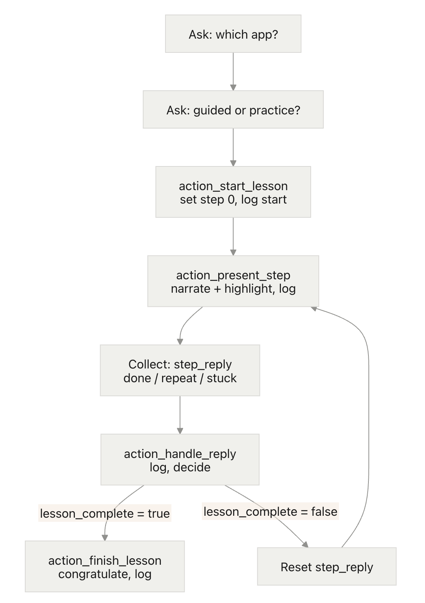

## 🧭 A coach, not an autopilot

```{=html}
<style>
:root { --coach-teal: #087e80; --coach-coral: #c44235; --coach-ink: #203033; }
.reveal { color: var(--coach-ink); font-size: 30px; }
.reveal h1, .reveal h2, .reveal h3 { letter-spacing: 0; text-transform: none; }
.reveal h2 { font-size: 1.48em; color: var(--coach-teal); border-bottom: 3px solid #d9e6e5; padding-bottom: .24em; margin-bottom: .55em; }
.reveal h3 { font-size: 1.12em; }
.reveal p, .reveal li { line-height: 1.38; }
.reveal table { font-size: .78em; width: 100%; }
.reveal table th { color: var(--coach-teal); }
.reveal table td, .reveal table th { padding: .4em .55em; }
.reveal pre { font-size: .63em; width: 100%; box-shadow: none; }
.reveal pre code { max-height: none; }
.reveal code { overflow-wrap: anywhere; }
.reveal pre code, .reveal pre code span { overflow-wrap: normal; }
.reveal div.sourceCode { border-left: 4px solid var(--coach-teal); background: #f3f7f7; }
.reveal pre > code.sourceCode { white-space: pre-wrap; }
.reveal pre.numberSource code > span { left: 0; width: calc(100% - 3em); margin-left: 3em; min-height: 1.25em; vertical-align: top; }
.reveal pre.numberSource code > span > a:first-child::before { position: absolute; left: -3em; width: 2em; padding: 0; }
.reveal blockquote { width: auto; background: #edf6f5; border-left: 5px solid var(--coach-teal); padding: .6em .9em; font-style: normal; }
.reveal .checkpoint { border-top: 3px solid var(--coach-coral); padding-top: .65em; margin-top: .8em; }
.reveal .eyebrow { color: var(--coach-coral); font-weight: 700; font-size: .7em; text-transform: uppercase; letter-spacing: 0; }
.reveal .compact { font-size: .85em; }
.reveal .section-slide h2 { color: white; border-color: #ffffff66; font-size: 2em; }
.reveal .section-slide { color: white; }
.reveal .section-slide .eyebrow { color: #ffe29a; }
.reveal .section-slide strong { color: #ffe29a; }
.reveal .slide-number { background: var(--coach-teal); color: white; }
.reveal .mermaid img { max-height: 640px; object-fit: contain; }
</style>
```

**AI 380: Human-AI Interaction · Willamette University**

A conversational coach that teaches older adults to use a new app, **one step at a time**, by text or voice.

::: columns
::: {.column width="50%"}
### Build the conversation

- Flows and branching
- Slots and responses
- Python custom actions
:::
::: {.column width="50%"}
### Design for the person

- Guided and practice modes
- Repeat, help, and progress
- Confirmation and logging
:::
:::

## 🛠️ How to use this tutorial

You write every project file yourself.

1. Read the concept.
2. Add the code to the named file.
3. Run the check.
4. Continue only when the checkpoint passes.

::: {.checkpoint}
**Verification boundary:** The supplied tutorial reports testing its Python actions with the Rasa SDK. Rasa Pro training, YAML execution, and Inspector behavior. The checkpoints catch integration problems early.
:::

<!-- ## ① Define the experience {.section-slide background-color="#087e80"}

::: {.eyebrow}
Part 1 · Problem, scope, and conversation design
:::

From “help me use an app” to a clear, testable interaction.

**Present → wait → handle → repeat** -->

## 🎯 Make the problem explicit

| Item | Explanation |
|---|---|---|
| Target problem |An older adult wants to learn **one app task**, such as a video call or medication reminder, but gets lost in unfamiliar screens. |
| User need | Give **one instruction at a time**, wait for “Done,” and support repeat, help, and progress requests. |
| AI artefact | Text + voice, button choices, a guided loop, practice mode, a step log, and a highlight message for a future front end. |

## 🔎 Three scope decisions

1. **Two lessons, four steps each:** `video_call` and `medication_reminder`.
2. **Rasa manages conversation, not the screen overlay.** It can send `{"highlight": "add_reminder_button"}`; a front end must draw the highlight.
3. **Buttons are for text.** Every question must also make sense when spoken without buttons.

> **FamilyCall and PillTime are fictional demo apps.** Replace their lesson text with verified instructions for any real app. Do not treat this tutorial as real app instructions or medical advice.

## 💬 Happy path · Choose a lesson

**COACH:** Which app would you like to learn? Video calls, or medication reminders? *[Buttons]*

**USER:** Medication reminder. *[Tap or speech]*

**COACH:** Do you want me to walk you through it, or would you like to practice? *[Buttons]*

**USER:** Walk me through it.

**COACH:** Great. Let's learn PillTime in guided mode. There are 4 steps. After each step, say “done.”

## 💬 Happy path · One step at a time

**COACH:** Step 1 of 4. Open the PillTime app by tapping the orange pill icon. *[highlight: `app_icon`]*

**USER:** Done.

**COACH:** Well done! Step 2 of 4. Tap the large green “Add Reminder” button. *[highlight: `add_reminder_button`]*

**USER:** Done.

*Continue through steps 3 and 4…*

**COACH:** Congratulations! You finished the PillTime lesson.

## 🔀 Branches are part of the experience

| User says | Coach does | Logic lives in |
|---|---|---|
| “Done” | Advances or finishes | `action_handle_reply` |
| “Again” / “repeat” | Repeats the same step | `action_handle_reply` |
| “I'm stuck” | Repeats the step **plus a tip** | `action_handle_reply` |
| “Where am I?” | Reports progress; returns to the same step | Separate side flow |
| “What's the weather?” | Brief small-talk response, then return | Template chitchat pattern |

## 🪜 Practice mode · Fade the support

::: columns
::: {.column width="50%"}
### Guided

Full instruction and a highlight message.

“Open PillTime by tapping the orange pill icon.”
:::
::: {.column width="50%"}
### Practice

Only the goal; **no highlight**.

“Your turn! Your goal: open PillTime.”
:::
:::

If the user says **“stuck,”** reveal the full instruction and a tip.

**Fading support:** Help is available, but not forced.

## 📝 Logging · Make the interaction inspectable

Append one JSON line for each important event:

- Lesson started
- Step shown
- User reply
- Lesson completed

A caregiver or researcher could review the record later, **with appropriate access and consent**.

::: {.notes}
Ask students to distinguish an operational log from a learning assessment. A completed step records what the user confirmed, not independent proof that they performed or learned the task. A sender ID is pseudonymous, not automatically anonymous.
:::

## 🗺️ The lesson loop

::: {style="text-align: center;"}
{width=40% fig-align="center"}
:::

<!-- - **Start:** set step 0 and log. **Present:** narrate, send highlight, log.

- **Handle:** log the reply and update state. **Repeat:** until complete. -->

## 🧩 Blueprint · Flows and user choices

| Concept | Name | Job |
|---|---|---|
| Flow | `learn_app` | Main lesson loop |
| Flow | `where_am_i` | Side question without breaking the lesson |
| Categorical slot | `app_choice` | `video_call` or `medication_reminder` |
| Boolean slot | `practice_mode` | `true`: practice; `false`: guided |
| Categorical slot | `step_reply` | `done`, `repeat`, or `stuck` |

## 🧠 Blueprint · Controlled state and responses

| Concept | Name | Job |
|---|---|---|
| Float slot | `step_index` | Current step; zero-based |
| Float slot | `total_steps` | Number of steps |
| Boolean slot | `extra_help` | Show a tip on the next presentation? |
| Boolean slot | `lesson_complete` | Finish or loop? |
| Response | `utter_ask_app_choice` | Ask which lesson |
| Response | `utter_ask_practice_mode` | Ask guided or practice |
| Response | `utter_ask_step_reply` | Ask done, repeat, or stuck |

## ⚙️ Blueprint · Custom actions

| Action | Job |
|---|---|
| `action_start_lesson` | Initialize the lesson and log the start |
| `action_present_step` | Narrate and send the highlight |
| `action_handle_reply` | Interpret done / repeat / stuck |
| `action_finish_lesson` | Congratulate and log completion |
| `action_where_am_i` | Report progress |

> **Flow:** what happens next. **Slot:** what is remembered. **Response:** fixed words. **Action:** computation that returns state changes.

## ② Build the assistant {.section-slide background-color="#263b3e"}

::: {.eyebrow}
Part 2 · Write, inspect, and test
:::

**Slots → responses → flows → actions**

Keep conversation order in flows and computation in Python.

## 📦 Step 0 · Create the project {#create-project}

**10 minutes**

```bash
mkdir App_Coach && cd App_Coach
rasa init --template tutorial
export RASA_LICENSE=YOUR_LICENSE_KEY
```

The template starts as a money-transfer demo. You will replace its content.

::: {.checkpoint}
**Checkpoint 0:** Run `rasa train` on the untouched template. Fix installation or license issues before changing anything.
:::

## 🗂️ Keep the scaffold; replace the lesson

```text
App_Coach/
├── actions/
│   ├── __init__.py      KEEP (empty)
│   ├── actions.py       REPLACE (Step 5)
│   └── lessons.py       NEW (Step 5)
├── data/
│   ├── flows.yml        REPLACE (Steps 3 and 4)
│   └── patterns.yml     KEEP (small talk)
├── domain.yml          REPLACE (Steps 1 and 2)
├── config.yml          KEEP
├── endpoints.yml       KEEP (embedded actions)
└── credentials.yml     KEEP (REST and browser_audio)
```

## 🧠 Step 1 · Slots are memory

**10 minutes · Start replacing `domain.yml`**

- `from_llm`: filled from the user's words by the language model.
- `controlled`: programmatically set, rather than inferred from chat; the tutorial also uses explicit button slot assignments.

**Type choices**

- **Categorical:** a closed set of choices; still validate inputs at trust boundaries.
- **Bool:** two-way decisions such as guided/practice or complete/incomplete.
- **Float:** numeric slots; convert to `int` when using an index in Python.

## 🧠 Slots · App and mode

**`domain.yml` · Begin the file with this block**

```yaml
version: "3.1"

slots:
  app_choice:
    type: categorical
    values:
      - video_call
      - medication_reminder
    mappings:
      - type: from_llm

  practice_mode:
    type: bool
    mappings:
      - type: from_llm
```

## 🧠 Slots · Reply and step index

**Continue inside `slots:` at the same indentation**

```yaml
  step_reply:
    type: categorical
    values:
      - done
      - repeat
      - stuck
    mappings:
      - type: from_llm

  step_index:
    type: float
    initial_value: 0
    mappings:
      - type: controlled
```

## 🧠 Slots · Progress and help

**Continue inside `slots:`**

```yaml
  total_steps:
    type: float
    initial_value: 0
    mappings:
      - type: controlled

  extra_help:
    type: bool
    initial_value: false
    mappings:
      - type: controlled
```

## 🛡️ Slots · Who controls completion?

**Continue inside `slots:`**

```yaml
  lesson_complete:
    type: bool
    initial_value: false
    mappings:
      - type: controlled
```

**Discuss:** Why are `step_index` and `lesson_complete` controlled?

So saying “step 9” or “I'm finished” does not directly assign internal progress; the code updates it based on the reply.

::: {.checkpoint}
**Checkpoint 1:** Keep the file open. Do not train yet.
:::

## 💬 Step 2 · Responses and buttons

**15 minutes · Continue `domain.yml`**

A collection step asks using `utter_ask_<slot_name>`.

Buttons contain a visible **title** and a **payload**:

```text
/SetSlots(slot_name=value)
```

- Case-sensitive syntax; maximum **10 slot pairs** per button.
- Values cannot contain commas or parentheses.
- Supports slot types except `list`.

> **Voice rule:** Ask the full question in words. Do not rely on “Tap a button below.”

## 💬 Responses · Choose an app

**Add a top-level `responses:` block**

```yaml
responses:
  utter_ask_app_choice:
    - text: "Which app would you like to learn? Video calls, or medication reminders?"
      buttons:
        - title: "Video calls"
          payload: "/SetSlots(app_choice=video_call)"
        - title: "Medication reminder"
          payload: "/SetSlots(app_choice=medication_reminder)"
```

One question, two clear choices, and wording that works in speech.

## 🪜 Responses · Guided or practice?

**Continue inside `responses:`**

```yaml
  utter_ask_practice_mode:
    - text: "Do you want me to walk you through it, or would you like to practice on your own?"
      buttons:
        - title: "Walk me through it"
          payload: "/SetSlots(practice_mode=false)"
        - title: "Let me practice"
          payload: "/SetSlots(practice_mode=true)"
```

**Button:** assigns the slot directly. **Voice:** the LLM interprets the user's words.

## 🔁 Responses · Done, again, or stuck?

**Continue inside `responses:`**

```yaml
  utter_ask_step_reply:
    - text: "Say 'done' when you have finished this step. Say 'again' to hear it once more, or 'stuck' if you need help."
      buttons:
        - title: "Done"
          payload: "/SetSlots(step_reply=done)"
        - title: "Say it again"
          payload: "/SetSlots(step_reply=repeat)"
        - title: "I'm stuck"
          payload: "/SetSlots(step_reply=stuck)"
```

Short titles; one decision per question; three buttons at most.

## 🎛️ Separate content from presentation

- “Say it again” on a button and “again” in voice can set the same `repeat` value.
- The front end controls button size, icons, and rendering.
- Rasa provides short, clear labels and payloads.
- Image-based choices are an extension, not a substitute for readable labels.

**Declare actions under a new top-level key in `domain.yml`:**

```yaml
actions:
  - action_start_lesson
  - action_present_step
  - action_handle_reply
  - action_finish_lesson
  - action_where_am_i
```

## ☀️ Keep the chitchat response

**Inside `responses:` · Indent like the other `utter_...` entries**

```yaml
  utter_free_chitchat_response:
    - text: "placeholder"
      metadata:
        rephrase: True
        rephrase_prompt: |
          The following is a conversation with a friendly AI assistant called App Coach.
          The assistant helps older adults learn to use new apps, one small step at a time.
          The assistant is warm, patient, and speaks in short, clear sentences.
          The user is making small talk. Respond briefly and kindly, then invite the user to continue the lesson.
          Context / previous conversation with the user:
          {{history}}
          {{current_input}}
          Suggested AI Response:
```

## ✅ Checkpoint 2 · Check the domain

Organize the four top-level keys as:

**`version` · `slots` · `actions` · `responses`**

There should be **four** `utter_...` entries inside the single `responses:` block.

```bash
python -c "import yaml; d=yaml.safe_load(open('domain.yml')); print(list(d), list(d['responses']))"
```

This checks YAML structure, **not** Rasa semantic validity.

## 🛤️ Step 3 · Your first flow

**15 minutes · Replace `data/flows.yml`**

| Step | Meaning |
|---|---|
| `collect: some_slot` | Request the value using `utter_ask_some_slot`; filled values may skip collection |
| `action: name` | Run a response or custom action |
| `set_slots` | Assign values; use `null` to clear |
| `next:` | Choose the next step; branch with `if / then / else` |
| `id:` | Label a step so another step can jump to it |

**Flow `description`:** Tell the LLM what the flow does **for the user**.

## 🛤️ Flow · Choose the lesson

**`data/flows.yml` · First half of `learn_app`**

```yaml
flows:
  learn_app:
    name: learn an app
    description: >
      Coach the user step by step through learning how to use a new app,
      such as making video calls or setting a medication reminder.
      Use when the user wants to learn, set up, install, practice, or get
      help using an app.
    steps:
      - collect: app_choice
        description: "The app the user wants to learn: video_call or medication_reminder."
      - collect: practice_mode
        description: >
          true if the user wants to practice on their own with less help;
          false if the user wants to be walked through step by step.
      - action: action_start_lesson
```

## 🔍 Read the flow before you run it

- `collect: app_choice` uses `utter_ask_app_choice`, including its buttons.
- “Teach me video calls” may already fill `app_choice`, so the app question can be skipped.
- A description under `collect` guides interpretation of that slot.
- `action_start_lesson` is the custom action you will write in Step 5.

::: {.checkpoint}
**Checkpoint 3:** The action does not exist yet. Continue building before testing.
:::

## 🔁 Step 4 · Present, wait, handle

**20 minutes · Append below `action_start_lesson` in `learn_app`**

```yaml
      - id: present
        action: action_present_step

      - id: ask_reply
        collect: step_reply
        ask_before_filling: true
        description: >
          What the user says about the current step: done if they finished it,
          repeat if they want to hear it again, stuck if they need help.

      - action: action_handle_reply
        next:
          - if: slots.lesson_complete
            then: wrap_up
          - else: reset_reply
```

## 🔁 Flow · Reset or finish

**Continue at the same step-list indentation**

```yaml
      - id: reset_reply
        set_slots:
          - step_reply: null
        next: present

      - id: wrap_up
        action: action_finish_lesson
```

1. Present the current step; collect a fresh reply.
2. Handle the reply and update the state.
3. If complete, jump to `wrap_up`; otherwise clear the reply and return to `present`.

## 🧹 Why clear the reply?

**`step_reply: null`** prevents the last “done” from becoming a stale reply for a new step.

`ask_before_filling: true` requests a fresh answer rather than silently relying on a previously filled value. Verify collection behavior in your Rasa version.

> **Trace it:** Start at `step_index = 0`. The user says “stuck.” Which action changes `extra_help`, and when does it return to `false`?

::: {.notes}
Expected trace: action_handle_reply sets extra_help to True; reset_reply clears step_reply; present repeats the current instruction with a tip; action_present_step resets extra_help to False. The flow has not advanced the step index.
:::

## 🧭 Add a progress digression

**One side flow · Same indentation as `learn_app:`**

```yaml
  where_am_i:
    name: where am I
    description: >
      The user asks which step they are on, how far along they are,
      or how many steps are left in the current lesson.
    steps:
      - action: action_where_am_i
```

CALM can pause `learn_app`, run this side flow, and resume the lesson at its pending reply collection.

**Test that resumption** rather than assuming it worked.

## ✅ Checkpoint 4 · Parse and verify assumptions

```bash
python -c "import yaml; d=yaml.safe_load(open('data/flows.yml')); print(list(d['flows']))"
```

Expected: `['learn_app', 'where_am_i']`.

**Version-sensitive items retained from the source tutorial:**

<!-- - Backward jump: `next: present`.
- Condition syntax: `slots.lesson_complete` versus bare `lesson_complete`.

The source cites Rasa's transfer example for backward jumps but flags the general behavior for verification. Retrain and inspect the loop in your installed version. -->

## ⚙️ Step 5 · Custom actions

**30 minutes · Python does the computation**

| Operation | Rasa SDK API |
|---|---|
| Read memory | `tracker.get_slot("name")` |
| Speak | `dispatcher.utter_message(text="...")` |
| Update memory | Return `SlotSet("name", value)` events |
| Other computation | Read content, call APIs, write logs |

The template's `endpoints.yml` uses `action_endpoint: actions_module: "actions"`, so actions run **in-process**. No separate action server is needed.

**Read slots → decide → speak → log → return SlotSets**

## 📚 Step 5a · Lesson content, not logic

**Create `actions/lessons.py` · Add the following pieces in order**

```python
"""Lesson content and a tiny logger.
The apps below are FICTIONAL demo apps. Replace the text with the real steps of your own app."""
import json
import time
from pathlib import Path

LESSONS = {
    "video_call": {
        "title": "FamilyCall (demo app)",
        "steps": [
```

Each step has `instruction` (guided), `goal` (practice), `tip` (help), and `highlight` (front-end element name).

Teachers can edit the content without changing the action logic.

## 📹 FamilyCall · Steps 1 and 2

**Continue inside the `video_call` steps list**

```python
            {"instruction": "Find the blue 'FamilyCall' icon on your home screen and tap it once.",
             "goal": "Open the FamilyCall app.",
             "tip": "The icon is a blue circle with a white camera. If you cannot see it, swipe left on your home screen.",
             "highlight": "app_icon"},
            {"instruction": "Tap the large green 'Call' button at the bottom of the screen.",
             "goal": "Start a new call.",
             "tip": "The button is the biggest one on the screen, near your thumb.",
             "highlight": "call_button"},
```

These are **fictional screens**, not instructions for a real video-call app.

## 📹 FamilyCall · Steps 3 and 4

**Continue, then close the first lesson**

```python
            {"instruction": "Tap your daughter's photo in the contact list.",
             "goal": "Choose who to call.",
             "tip": "Contacts are shown as photos. Scroll down gently if you do not see her.",
             "highlight": "contact_photo"},
            {"instruction": "Wait for her to answer. When you see her face, say hello! To finish, tap the red 'End' button.",
             "goal": "Finish the call.",
             "tip": "The red button is at the bottom middle of the screen.",
             "highlight": "end_button"},
        ],
    },
```

## ⏰ PillTime · Steps 1 and 2

**Continue inside `LESSONS`**

```python
    "medication_reminder": {
        "title": "PillTime (demo app)",
        "steps": [
            {"instruction": "Open the 'PillTime' app by tapping the orange pill icon.",
             "goal": "Open PillTime.",
             "tip": "The icon is orange with a white pill shape.",
             "highlight": "app_icon"},
            {"instruction": "Tap the large green 'Add Reminder' button.",
             "goal": "Start a new reminder.",
             "tip": "The button is at the bottom of the screen and has a plus sign.",
             "highlight": "add_reminder_button"},
```

## ⏰ PillTime · Steps 3 and 4

**Close the steps, lesson, and `LESSONS` dictionary**

```python
            {"instruction": "Type the name of your medicine, then tap 'Next'.",
             "goal": "Name the medicine.",
             "tip": "You can also tap the microphone on the keyboard and say the name.",
             "highlight": "medicine_name_field"},
            {"instruction": "Pick the time of day you take it, then tap the green 'Save' button.",
             "goal": "Set the time and save.",
             "tip": "Tap the clock face, move the hands, and press 'OK'. Then press Save.",
             "highlight": "save_button"},
        ],
    },
}
```

## 📝 A small JSON-lines logger

**Append to `actions/lessons.py` after `LESSONS`**

```python
LOG_FILE = Path("lesson_log.jsonl")


def log_event(sender_id, app, step, event):
    """Append one JSON line per event. Open the file later to review what happened."""
    row = {"time": time.strftime("%Y-%m-%d %H:%M:%S"), "user": sender_id,
           "app": app, "step": step, "event": event}
    with LOG_FILE.open("a", encoding="utf-8") as f:
        f.write(json.dumps(row) + "\n")
```

The file is created in the directory where the assistant is launched.

## 🧰 Step 5b · Imports and a helper

**Replace `actions/actions.py` · Piece 1**

```python
from typing import Any, Dict, List, Text

from rasa_sdk import Action, Tracker
from rasa_sdk.events import SlotSet
from rasa_sdk.executor import CollectingDispatcher

from .lessons import LESSONS, log_event


def _step(tracker: Tracker):
    """Return (app, index, step_dict) for the current lesson step."""
    app = tracker.get_slot("app_choice")
    index = int(tracker.get_slot("step_index") or 0)
    return app, index, LESSONS[app]["steps"][index]
```

The dot in `.lessons` means “the module next to this one” in the `actions` package.

## 🚀 Start the lesson · Validate and log

**`actions/actions.py` · Piece 2, first class**

```python
class ActionStartLesson(Action):
    def name(self) -> Text:
        return "action_start_lesson"

    def run(self, dispatcher: CollectingDispatcher, tracker: Tracker, domain: Dict[Text, Any]) -> List[Dict[Text, Any]]:
        app = tracker.get_slot("app_choice")
        if app not in LESSONS:
            dispatcher.utter_message(text="Sorry, I do not have a lesson for that app yet.")
            return []
        total = len(LESSONS[app]["steps"])
        log_event(tracker.sender_id, app, 0, "lesson_started")
        mode = "practice mode" if tracker.get_slot("practice_mode") else "guided mode"
```

## 🚀 Start the lesson · Welcome and reset

**Continue inside `ActionStartLesson.run`**

```python
        dispatcher.utter_message(
            text=f"Great. Let's learn {LESSONS[app]['title']} in {mode}. There are {total} steps. "
                 "After each step, say 'done'. Say 'again' to hear it once more, or 'stuck' if you need help.")
        return [SlotSet("step_index", 0.0), SlotSet("total_steps", float(total)),
                SlotSet("extra_help", False), SlotSet("lesson_complete", False)]
```

**Reset at the start:** Custom-action state can persist. A new lesson must not inherit the old lesson's index, help flag, or completion flag.

## 📣 Present the step · Read state

**Add the second class at top level**

```python
class ActionPresentStep(Action):
    def name(self) -> Text:
        return "action_present_step"

    def run(self, dispatcher: CollectingDispatcher, tracker: Tracker, domain: Dict[Text, Any]) -> List[Dict[Text, Any]]:
        app, index, step = _step(tracker)
        total = len(LESSONS[app]["steps"])
        practice = bool(tracker.get_slot("practice_mode"))
        stuck = bool(tracker.get_slot("extra_help"))
```

The same content supports two different levels of assistance.

## 📣 Present the step · Choose support

**Continue inside `ActionPresentStep.run`**

```python
        if practice and not stuck:
            text = f"Step {index + 1} of {total}. Your turn! Your goal: {step['goal']}"
            payload = {}
        else:
            text = f"Step {index + 1} of {total}. {step['instruction']}"
            if stuck:
                text += f" Here is a tip: {step['tip']}"
            payload = {"highlight": step["highlight"], "step": index + 1}

        dispatcher.utter_message(text=text, json_message=payload or None)
        log_event(tracker.sender_id, app, index + 1, "step_shown_help" if stuck else "step_shown")
        return [SlotSet("extra_help", False)]
```

Practice gives the goal without a highlight. Help reveals the instruction and tip **once**.

## 🔦 What the highlight really does

`json_message=payload` attaches structured data to the response:

```json
{"highlight": "add_reminder_button", "step": 2}
```

- Text channels receive a `custom` payload alongside the text.
- A future front end can read `highlight` and draw a ring around that element.
- Inspect the payload in the event log; verify your Inspector's display.
- The payload itself is **not speech** and does not draw anything.

## 🔀 Handle the reply · Read and record

**Piece 3 · Add `ActionHandleReply` at top level**

```python
class ActionHandleReply(Action):
    def name(self) -> Text:
        return "action_handle_reply"

    def run(self, dispatcher: CollectingDispatcher, tracker: Tracker, domain: Dict[Text, Any]) -> List[Dict[Text, Any]]:
        app, index, _ = _step(tracker)
        total = len(LESSONS[app]["steps"])
        reply = tracker.get_slot("step_reply")
        log_event(tracker.sender_id, app, index + 1, f"reply_{reply}")
```

The action computes state changes; the flow decides which conversation step follows.

## 🔀 Handle the reply · Advance, help, repeat

**Continue inside `ActionHandleReply.run`**

```python
        if reply == "done":
            if index + 1 >= total:
                return [SlotSet("lesson_complete", True)]
            dispatcher.utter_message(text="Well done!")
            return [SlotSet("step_index", float(index + 1)), SlotSet("lesson_complete", False)]
        if reply == "stuck":
            return [SlotSet("extra_help", True), SlotSet("lesson_complete", False)]
        return [SlotSet("lesson_complete", False)]
```

**Done:** advance or finish. **Stuck:** keep the index and request help. **Repeat:** keep the same step unchanged.

## 🏁 Finish the lesson

**Add `ActionFinishLesson` at top level**

```python
class ActionFinishLesson(Action):
    def name(self) -> Text:
        return "action_finish_lesson"

    def run(self, dispatcher: CollectingDispatcher, tracker: Tracker, domain: Dict[Text, Any]) -> List[Dict[Text, Any]]:
        app = tracker.get_slot("app_choice")
        log_event(tracker.sender_id, app, int(tracker.get_slot("total_steps") or 0), "lesson_completed")
        extra = "" if tracker.get_slot("practice_mode") else " Want to try again without my help? Just say 'practice'."
        dispatcher.utter_message(text=f"Congratulations! You finished the {LESSONS[app]['title']} lesson.{extra}")
        return []
```

## 🧭 Answer “Where am I?”

**Add `ActionWhereAmI` at top level**

```python
class ActionWhereAmI(Action):
    def name(self) -> Text:
        return "action_where_am_i"

    def run(self, dispatcher: CollectingDispatcher, tracker: Tracker, domain: Dict[Text, Any]) -> List[Dict[Text, Any]]:
        app = tracker.get_slot("app_choice")
        if app not in LESSONS:
            dispatcher.utter_message(text="We have not started a lesson yet.")
            return []
        index = int(tracker.get_slot("step_index") or 0)
        dispatcher.utter_message(text=f"You are on step {index + 1} of {len(LESSONS[app]['steps'])} of the {LESSONS[app]['title']} lesson.")
        return []
```

## 🧪 Checkpoint 5a · Syntax, not integration

Parse both Python files without importing or running them:

```bash
python -c "import ast,sys; [ast.parse(open(f).read()) for f in ('actions/actions.py','actions/lessons.py')]; print('syntax OK')"
```

**Trace one round on paper:**

`step_index = 0` → user says **stuck** → `extra_help = True` → clear reply → present instruction + tip → `extra_help = False`.

> The action changes slots. The flow reads those slots to choose the next conversation step.

## 🧪 Checkpoint 5b · Optional SDK harness

**Create `try_actions.py` in the project root · Part 1**

```python
from rasa_sdk import Tracker
from rasa_sdk.executor import CollectingDispatcher
from actions import actions as A

slots = {"app_choice": "medication_reminder", "practice_mode": False, "step_index": 0.0,
         "step_reply": None, "extra_help": False, "total_steps": None, "lesson_complete": False}

def tracker():
    return Tracker("me", dict(slots), {}, [], False, None, {}, "action_listen")

def run(action):
    d = CollectingDispatcher()
    for e in action.run(d, tracker(), {}):
        slots[e["name"]] = e["value"]
    for m in d.messages:
        print("BOT:", m["text"], "| overlay:", m["custom"])
```

## 🧪 Checkpoint 5b · Exercise the actions

**Append to `try_actions.py` · Part 2**

```python
run(A.ActionStartLesson())
run(A.ActionPresentStep())
slots["step_reply"] = "stuck"; run(A.ActionHandleReply()); run(A.ActionPresentStep())
slots["step_reply"] = "done";  run(A.ActionHandleReply()); run(A.ActionPresentStep())
```

Run `python try_actions.py`.

**Expected:** Step 1 → Step 1 with a tip → “Well done!” → Step 2.

The run creates `lesson_log.jsonl`. Delete the scratch file and test log after reviewing them. This harness needs the Rasa SDK, but not a running Rasa Pro assistant.

## 💻 Step 6 · Train and test by text

**20 minutes**

```bash
rasa train
rasa inspect
```

Click **Inspect** to open the Flow, History, and Memory panels.

Run the following script and record actual behavior, including differences from the expected result.

## 💻 Test script · Start and recover

| # | Type or tap | Expected |
|---|---|---|
| 1 | “I want to learn an app” | Question with two buttons |
| 2 | **Medication reminder** | Guided/practice choice |
| 3 | **Walk me through it** | Welcome, Step 1 of 4, then reply question |
| 4 | **I'm stuck** | Step 1 repeated **with a tip** |
| 5 | “where am I?” | “You are on step 1 of 4…” then reply question |
| 6 | **Done** | “Well done!” then Step 2 |

## 💻 Test script · Repeat and practice

| # | Type or tap | Expected |
|---|---|---|
| 7 | “again” | Repeat Step 2 |
| 8 | **Done** three times, one reply per step | Steps 3 and 4, then congratulations |
| 9 | “I want to learn video calls” | App question skipped if slot is filled; mode question next |
| 10 | **Let me practice** | Goal only, without tip or highlight |
| 11 | “I'm stuck” | Full instruction and tip |
| 12 | “What a nice day” | Brief small talk, then continue |

## 🔬 Watch the state, not just the chat

- **Flow:** active step and loop.
- **History:** `learn_app` becomes **Interrupted** during `where_am_i`, then **Active** again.
- **Memory:** `step_index` advances 0, 1, 2…; `lesson_complete` becomes `true` at the end; `extra_help` enables one helped presentation.
- **Chat log:** inspect custom payloads such as `{"highlight": ..., "step": ...}`.

::: {.checkpoint}
**Checkpoint 6:** Complete a guided lesson, a stuck-and-recover interaction, a progress digression, and a practice run.
:::

## 📝 Step 7 · Read the log

**5 minutes · Open `lesson_log.jsonl` where you launched Rasa**

```json
{"time": "2026-10-25 23:13:22", "user": "u1", "app": "medication_reminder", "step": 1, "event": "step_shown"}
{"time": "2026-10-25 23:13:22", "user": "u1", "app": "medication_reminder", "step": 1, "event": "reply_stuck"}
```

1. Which step needed the most help?
2. How could a caregiver use this log? What privacy concerns arise?
3. Why use a sender ID rather than a name? What could still identify someone?

## 🎙️ Step 8 · Same flows, different channel

**15 minutes · Test by text before speech**

The template's `browser_audio` channel uses Deepgram for listening and speaking.

```bash
export DEEPGRAM_API_KEY=YOUR_DEEPGRAM_KEY
rasa inspect
```

Switch to voice, allow microphone access, and say:

**“I want to learn the medication reminder.”**

## 🎙️ Voice reveals new interaction risks

| Issue | Design response |
|---|---|
| Buttons are unavailable | List choices in the spoken question |
| Long coach messages | One idea per message; short sentences |
| User says “Done” during speech | Configure and test channel interruptions |
| “again” or “done” is misheard | Record errors; consider synonyms such as “finished,” “okay,” or “next” in the reply description |
| Highlight payload has no sound | It is overlay data, not speech |

::: {.checkpoint}
**Checkpoint 8:** Finish a lesson by voice. Record two misrecognized words, or report none if none occurred.
:::

<!-- ## 🔦 Step 9 · From payload to overlay

**Optional discussion · Rasa supplies only half the artefact**

1. A web/mobile front end receives the response and its `custom` payload.
2. It reads `highlight`, for example `add_reminder_button`.
3. It finds the element and draws a ring, arrow, or dimmed background.
4. A tap can send **“done”** back to Rasa as a confirmation gesture.

Compare **tap-to-confirm** with spoken “done”: which errors does each prevent, and which can it introduce?

## 🧱 Overlay extension · Build a mock app

The tutorial describes WebSocket voice custom payloads as separate **`custom` frames**. Verify the protocol in the documentation for your installed version.

Rasa's documentation does not provide the browser overlay demo used here; that front end is yours to build.

**Extension:** Build a one-page mock app with the elements named in `lessons.py` and a highlight ring.

> This assistant narrates, waits for confirmation, branches, logs, and names UI elements. It does not control or inspect a real phone screen.

## ③ Diagnose and extend {.section-slide background-color="#a93632"}

::: {.eyebrow}
Parts 3–5 · Troubleshooting, extensions, and reflection
:::

Make the assistant work, then ask whether it helps.

**Correct execution is not the same as useful learning.**

## 🧯 Troubleshooting · Flow and state

| Symptom | Check |
|---|---|
| Unknown action during training | `domain.yml` action names must exactly match each class's `name()` |
| App question never appears | LLM may have filled the slot already; test a vague opener |
| Coach races through steps | Check `reset_reply` and the indentation of the `step_reply: null` assignment |
| Loop never ends | Check `action_handle_reply` sets completion; verify condition syntax |
| `KeyError` in Python | Ensure `app_choice` is filled before actions run |

## 🧯 Troubleshooting · Restart, voice, and scope

| Symptom | Check |
|---|---|
| Second lesson starts at wrong step | `action_start_lesson` must reset `step_index` |
| No spoken replies | Key exported in the launch terminal? Microphone allowed? |
| Chitchat says “placeholder” | Restore template `nlg: rephrase` in `endpoints.yml` |
| Unrelated messages start `learn_app` | Tighten its description and retrain | -->

## 🧪 Extensions · Choose one

1. **Third lesson:** Add content to `lessons.py`; the reusable lesson loop should not need to change.
2. **Image-supported choices:** Explore response images and accessible labels; widget rendering determines their presentation.
3. **Go back:** Add `back` to `step_reply` and decrement the index without going below zero.
4. **Quit politely:** Add `stop_lesson`, log `lesson_abandoned`, and say goodbye.
5. **Summary report:** Read the JSON-lines log and report which steps needed help, with consent and access controls.

<!-- ## 💭 Reflection · Agency and learning

1. Which of Microsoft's 18 HAI guidelines connect to one-step instructions, tips, practice mode, progress, and logging?
2. What happens if “not done” becomes `done`? What does the LLM control, and what is controlled only by code?
3. When could practice mode frustrate a learner? What makes help easy to recover?

::: {.notes}
Controlled slots constrain direct assignment, but they do not make the assistant immune to incorrect LLM interpretation. A mistaken step_reply can still cause the action to advance. Ask students to propose a confirmation or correction interaction and discuss its added burden.
:::

## 🔐 Reflection · Privacy and evaluation

4. What does the log collect? Who should see it? What would informed consent look like for an older adult?
5. How would you evaluate whether the coach helps people **learn**, not only whether the software runs?

Consider task success, retention, help requests, correction effort, and the user's sense of control.

## ✅ Verification notes · Know what was tested

**Reported tested by the supplied tutorial:** Python actions with real Rasa SDK classes: guided loop, stuck, repeat, practice, logging, and highlight payloads.

**Not tested in that source build:** Rasa Pro training, domain and flow execution, Inspector behavior, and voice.

**Verify locally:** Backward jumps, exact condition syntax, custom payload display, and all checkpoints.

**Fictional lessons:** FamilyCall and PillTime are invented. This is not medical advice; a real medication coach requires health-professional review. -->

## 📖 Sources · Rasa primitives

- [Flows](https://rasa.com/docs/reference/primitives/flows)
- [Flow steps: collect, set_slots, branching, ask_before_filling](https://rasa.com/docs/reference/primitives/flow-steps/)
- [Slots: types, from_llm, controlled](https://rasa.com/docs/reference/primitives/slots)
- [Responses: buttons, SetSlots, custom payloads, images](https://rasa.com/docs/reference/primitives/responses)

## 📖 Sources · Actions and channels

- [Custom actions](https://rasa.com/docs/reference/primitives/custom-actions) · [Writing custom actions](https://rasa.com/docs/pro/build/custom-actions)
- [Rasa SDK actions](https://rasa.com/docs/reference/integrations/action-server/sdk-actions.md)
- [Trying your assistant: Inspector and voice](https://rasa.com/docs/pro/testing/trying-assistant)
- [Speech integrations](https://rasa.com/docs/reference/integrations/speech-integrations/)
- [WebSocket voice channel](https://rasa.com/docs/reference/channels/websockets-voice/)

## 🏁 App Coach · Demonstrate the whole loop

**Choose → present → confirm → recover → resume → finish**

- Complete a guided lesson and a practice lesson.
- Show a tip, a repeated step, and a resumed digression.
- Inspect a highlight payload and the event log.
- Finish a voice run and record recognition errors.
- Explain the trust boundary and a privacy safeguard.

> A useful coach supports the learner's pace, choices, and recovery.