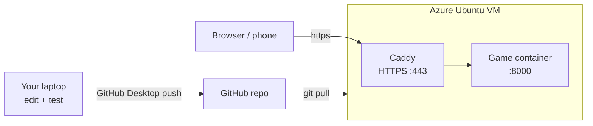

# Workshop: From Docker to a Live HTTPS Site on Azure

**Course:** Human-AI Interaction, Willamette University
**Running example:** `Calm_Wordle` (an accessible Wordle game with an optional Rasa assistant)
**Outcome:** Your project runs in Docker, lives in a GitHub repo, and is reachable from any phone or laptop at `https://<your-name>.<region>.cloudapp.azure.com`, using a free or student-credit Azure virtual machine.

---

## What you will build



You will do five things:

1. Package the project in a Docker image.
2. Test the container on your own machine.
3. Put the project in a GitHub repo.
4. Create a free Azure VM and open the web ports.
5. Pull the repo onto the VM and start it with automatic HTTPS.

## Why HTTPS is not optional

Browsers only allow the microphone (speech recognition) on `https://` pages or on `localhost`. A deployed voice app on plain `http://` will silently lose its microphone. The setup below gets a free certificate automatically.

## Important: what actually gets deployed

| Piece | In the Docker image? | Notes |
|---|---|---|
| `web_server.py`, `web/` | Yes | The game page and its JSON API |
| `actions/` game logic | Yes | Rules, hints, voice-command parser |
| Rasa server, trained `models/` | No | Needs a license and far more memory. See Part 10 |

So the live site is the visual and voice-command game. The Rasa chat and voice assistant is a separate, optional deployment.

---

## Prerequisites

- A working project folder (here: `Calm_Wordle`) that runs locally.
- [Docker Desktop](https://www.docker.com/products/docker-desktop/) installed and running.
- [GitHub Desktop](https://desktop.github.com/) and a GitHub account.
- An Azure account (Part 4).
- A terminal. On Windows use PowerShell. On macOS use Terminal.

---

## Part 1: Containerize the project

A **Dockerfile** is a recipe for building an image. An **image** is a frozen copy of your app plus everything it needs. A **container** is a running image.

### 1.1 Read the Dockerfile

`Calm_Wordle/Dockerfile`:

```dockerfile
FROM python:3.12-slim

WORKDIR /app
COPY actions/__init__.py actions/english.py actions/answers.py actions/wordle_logic.py actions/game.py actions/voice_commands.py actions/
COPY web/ web/
COPY web_server.py .

RUN useradd --create-home player && mkdir /data && chown player /data
USER player

ENV HOST=0.0.0.0 PORT=8000 SAVE_FILE=/data/saved_games.json
EXPOSE 8000
CMD ["python", "web_server.py"]
```

Line by line:

| Line | Why |
|---|---|
| `FROM python:3.12-slim` | Small official Python base image |
| `COPY ...` | Copies only the files the game needs. No models, no virtual environment, no saved games |
| `useradd` / `USER player` | The app runs as a normal user, not root. Safer if it is ever compromised |
| `HOST=0.0.0.0` | Listen on all interfaces so traffic from outside the container can reach it |
| `SAVE_FILE=/data/...` | Saved games go to `/data`, which we mount as a persistent volume |

### 1.2 Build and run it

From the `Calm_Wordle` folder:

```bash
docker build -t calm-wordle .
docker run --rm -p 8000:8000 calm-wordle
```

Open http://localhost:8000. If the game loads, containerization worked. Stop with `Ctrl+C`.

### 1.3 Keep saved games across restarts

A container's filesystem is deleted when the container is removed. A **volume** survives:

```bash
docker run --rm -p 8000:8000 -v games:/data calm-wordle
```

### Checkpoint

- [ ] `docker build` finishes without errors
- [ ] http://localhost:8000 shows the game

---

## Part 2: Add HTTPS with Docker Compose

**Docker Compose** runs several containers together from one file. We need two: the game, and **Caddy**, a web server that fetches and renews HTTPS certificates by itself.

### 2.1 `deploy/docker-compose.yml`

```yaml
services:
  game:
    build: ..
    restart: unless-stopped
    volumes:
      - games:/data

  caddy:
    image: caddy:2
    restart: unless-stopped
    ports:
      - "80:80"
      - "443:443"
    environment:
      DOMAIN: ${DOMAIN}
    volumes:
      - ./Caddyfile:/etc/caddy/Caddyfile:ro
      - caddy_data:/data
    depends_on:
      - game

volumes:
  games:
  caddy_data:
```

### 2.2 `deploy/Caddyfile`

```
{$DOMAIN} {
	encode gzip
	reverse_proxy game:8000
}
```

This means: for the site name in `DOMAIN`, get a certificate and forward requests to the `game` container on port 8000.

Key ideas:

- Only Caddy publishes ports to the internet. The game container is reachable only through Caddy.
- `restart: unless-stopped` brings both containers back after a VM reboot.
- `caddy_data` stores the certificates. Without it, each restart would request new ones and you could hit rate limits.

### 2.3 Test locally (optional)

Caddy treats `localhost` specially and makes its own local certificate:

```bash
cd deploy
DOMAIN=localhost docker compose up --build
```

Open https://localhost (accept the browser warning). Stop with `Ctrl+C`, then run `docker compose down`.

---

## Part 3: Put the project on GitHub

### 3.1 Add a `.gitignore`

In the `Calm_Wordle` folder, create `.gitignore`:

```
.DS_Store
__pycache__/
*.pyc
.venv/
.rasa/
models/
saved_games.json
.env
```

This keeps junk, large folders, player data and secrets out of the repo.

### 3.2 Create the repo with GitHub Desktop

1. **File → Add Local Repository…** and pick the `Calm_Wordle` folder. If it says "not a Git repository", click **create a repository**.
2. Check the **Changes** list. `Dockerfile`, `web_server.py`, `web/`, `actions/`, `deploy/` and `.gitignore` must appear. `models/`, `.rasa/` and `saved_games.json` must not.
3. Summary: `Initial commit`. Click **Commit to main**.
4. Click **Publish repository**. Choose private if you do not want it public.

The repo root must be the `Calm_Wordle` folder itself, because `docker-compose.yml` uses `build: ..` (the parent of `deploy/`).

### 3.3 The update loop (you will use this for the rest of the course)

1. Edit a file and save.
2. In GitHub Desktop, write a summary and click **Commit to main**.
3. Click **Push origin**.

The **Changes** list is empty when nothing has changed since the last commit. That is normal.

### Checkpoint

- [ ] The repo appears on github.com
- [ ] It contains `Dockerfile` and `deploy/` and does not contain `models/` or `.env`

---

## Part 4: Create the free Azure account

There are two ways to get free cloud credit. Pick one.

| Option | What you get | Needs |
|---|---|---|
| **Azure for Students** | Credit (about $100) and a set of free services, valid for 12 months, no credit card | A school email address |
| **Azure free account** | Free services for 12 months, including a monthly allowance of small Linux VM hours, plus a starter credit | A credit or debit card for identity check |

Sign-up pages and current offers change. Check the official pages before the workshop:

- https://azure.microsoft.com/free/students
- https://azure.microsoft.com/free

Look for the "B1s" Linux VM in the list of free services. This is the VM size used below. If the offer in your region lists a different size, use that one. Any small Linux VM with at least 1 GB RAM works for the game.

### Protect yourself from surprise charges

1. In the portal, open **Cost Management + Billing → Budgets** and create a budget of $5 with an email alert.
2. Remember that a stopped VM from the operating system (`shutdown`) still bills. Use **deallocate** (Part 9).

---

## Part 5: Create the VM

You can click through the portal, but the CLI is faster and repeatable. Use **Azure Cloud Shell**, which needs no installation.

1. Sign in to https://portal.azure.com.
2. Click the `>_` icon in the top bar and choose **Bash**. Accept the storage prompt if it appears.

### 5.1 Pick unique names

Replace `yourname` with letters and numbers only (lowercase). The DNS label must be unique across the whole Azure region.

```bash
RG=calmwordle-rg
VM=calmwordle-vm
LOC=westus2
DNS=calmwordle-yourname
```

`westus2` is close to Oregon. If the VM size is unavailable, try `westus3`, `eastus` or `centralus`.

### 5.2 Create the resource group and the VM

A **resource group** is a folder for related Azure resources. Deleting it removes everything inside, which makes cleanup easy.

```bash
az group create --name $RG --location $LOC

az vm create \
  --resource-group $RG \
  --name $VM \
  --image Ubuntu2404 \
  --size Standard_B1s \
  --admin-username azureuser \
  --generate-ssh-keys \
  --public-ip-sku Standard \
  --public-ip-address-dns-name $DNS
```

Notes:

- `--generate-ssh-keys` creates a key pair in Cloud Shell if you do not already have one. You log in with this key, not a password.
- If you get `The requested VM size is not available`, list the sizes in your region with `az vm list-skus --location $LOC --size Standard_B1 --output table` and pick an available one that your free offer covers, then rerun with `--size`.
- The command prints JSON. Look for `publicIpAddress`.

### 5.3 Open the web ports

SSH (22) is open by default. Web traffic needs 80 and 443. Port 80 is required for the certificate check.

```bash
az vm open-port --resource-group $RG --name $VM --port 80 --priority 900
az vm open-port --resource-group $RG --name $VM --port 443 --priority 901
```

### 5.4 Get your site address

```bash
az vm show -d --resource-group $RG --name $VM --query fqdns -o tsv
```

The result looks like `calmwordle-yourname.westus2.cloudapp.azure.com`. This is your free domain name. Write it down.

If the result is empty, build it yourself: `$DNS.$LOC.cloudapp.azure.com`.

### Checkpoint

- [ ] You have a public IP and a `*.cloudapp.azure.com` name

---

## Part 6: Prepare the server

### 6.1 Log in

From Cloud Shell:

```bash
ssh azureuser@$DNS.$LOC.cloudapp.azure.com
```

Type `yes` to trust the host. The prompt changes to `azureuser@calmwordle-vm`.

To log in from your own laptop instead, copy the private key from Cloud Shell or create a key on your laptop and pass it with `--ssh-key-values`.

### 6.2 Install Docker

```bash
sudo apt-get update
curl -fsSL https://get.docker.com | sudo sh
sudo usermod -aG docker $USER
exit
```

Log in again so the new group membership applies. Then check:

```bash
docker --version
docker compose version
```

### Checkpoint

- [ ] Both commands print a version number
- [ ] `docker ps` runs without `sudo`

---

## Part 7: Get your code onto the VM

### 7.1 Public repo

```bash
cd ~
git clone https://github.com/YOUR_GITHUB_USER/Calm_Wordle.git calm-wordle
```

Use your real username and repo name. The repo name is case-sensitive in the URL. Find them in GitHub Desktop under **Repository → Repository settings → Remote**.

### 7.2 Private repo: deploy key

A **deploy key** gives this one VM read-only access to this one repo.

On the VM:

```bash
ssh-keygen -t ed25519 -C "azure-vm" -f ~/.ssh/deploy_key -N ""
cat ~/.ssh/deploy_key.pub
```

On GitHub: repo **Settings → Deploy keys → Add deploy key**. Paste the line, leave "Allow write access" unchecked, and save.

Back on the VM:

```bash
cat >> ~/.ssh/config <<'EOF'
Host github.com
  IdentityFile ~/.ssh/deploy_key
  IdentitiesOnly yes
EOF
chmod 600 ~/.ssh/config
ssh -T git@github.com
```

You should see `Hi USER/REPO! You've successfully authenticated`. Then:

```bash
cd ~
git clone git@github.com:YOUR_GITHUB_USER/Calm_Wordle.git calm-wordle
```

### Common mistakes

| Message | Cause |
|---|---|
| `Authentication failed` over HTTPS | The repo is private. GitHub does not accept account passwords for Git. Use the deploy key |
| `Repository not found` | Wrong username or repo name, or the deploy key was added to a different repo |
| Copying `YOUR_GITHUB_USER` literally | Replace placeholders with your real values |

---

## Part 8: Launch with HTTPS

On the VM:

```bash
cd ~/calm-wordle/deploy
echo "DOMAIN=calmwordle-yourname.westus2.cloudapp.azure.com" > .env
docker compose up -d --build
docker compose ps
docker compose logs -f caddy
```

Use the exact name from step 5.4. Docker Compose reads `.env` in the same folder automatically.

Watch the Caddy log. After about a minute you should see a line saying the certificate was obtained. Press `Ctrl+C` to stop reading logs. The containers keep running.

Open `https://calmwordle-yourname.westus2.cloudapp.azure.com` on your laptop and on your phone. Test the microphone.

Test from the command line using GET. `curl -I` sends HEAD, which this small server does not implement, so it returns 501 even when everything works:

```bash
curl -s -o /dev/null -w "%{http_code}\n" https://calmwordle-yourname.westus2.cloudapp.azure.com/
```

It should print `200`.

### Deploy an update

On your laptop: edit, commit, **Push origin**. Then on the VM:

```bash
cd ~/calm-wordle && git pull && cd deploy && docker compose up -d --build
```

Saved games live in the `games` volume, so they survive rebuilds.

### Troubleshooting

| Symptom | Likely cause | Fix |
|---|---|---|
| Browser cannot connect | Ports 80/443 not open in Azure | Rerun the two `az vm open-port` commands |
| Browser says certificate invalid or connection reset | Certificate not issued yet | `docker compose logs caddy`. Wait a minute |
| Caddy log shows `could not get certificate`, `timeout` | Port 80 blocked, or wrong `DOMAIN` | Check the name with `cat .env`. Check NSG rules in the portal under VM, Networking |
| Log mentions a rate limit | Many students requested certificates for the same Azure domain suffix | Caddy automatically falls back to a second certificate provider. Wait and check the log again |
| `permission denied` running `docker` | You did not log out and back in after `usermod` | `exit`, then log in again |
| `variable DOMAIN is not set` warning | No `.env` in `deploy/` | Recreate it as in this part |
| Site loads but microphone is blocked | Page is on `http://` | Use the `https://` address |
| `port is already allocated` | Another service uses 80 or 443 | `sudo ss -tlnp | grep -E ':80 |:443 '` to find it |
| Build runs out of memory | Very small VM | Add swap: `sudo fallocate -l 1G /swapfile && sudo chmod 600 /swapfile && sudo mkswap /swapfile && sudo swapon /swapfile` |

---

## Part 9: Stop, restart and clean up

Azure bills for compute while a VM is allocated, even when the operating system is shut down. Deallocate from the CLI:

```bash
az vm deallocate --resource-group calmwordle-rg --name calmwordle-vm
az vm start      --resource-group calmwordle-rg --name calmwordle-vm
```

The public IP and DNS name stay the same when the Standard SKU IP is used. Containers with `restart: unless-stopped` start again by themselves.

When the course is over, delete everything in one step:

```bash
az group delete --name calmwordle-rg --yes
```

---

## Part 10 (optional): Deploying the Rasa assistant itself

The live site above does not run Rasa. To run the Rasa assistant on the same kind of VM:

1. Use the compose file from the Lab 4 template, which uses the official `rasa/rasa-pro` image and mounts your project folder.
2. Put `RASA_LICENSE` and any API keys in a `.env` file on the VM. **Never commit `.env`.** It is already in `.gitignore`.
3. Train a model on the VM or copy one in. `rasa/rasa-pro` is a large image and needs considerably more memory than 1 GB. Use a larger VM size (for example 4 GB RAM), which uses credit and is not covered by the free VM allowance.
4. Do not publish port 5005 to the whole internet. Either keep it on localhost and put it behind Caddy, or restrict it in the Azure network rules to your IP. An open Rasa API lets anyone spend your LLM keys.
5. In `credentials.yml`, keep the secrets in environment variables.

For the Calm_Wordle voice page, `web/voice.html` expects Rasa on port 5005 with the `websockets_voice` channel. Check `credentials.yml` and `endpoints.yml` before putting it online.

---

## Part 11 (optional): Use your own domain

1. Keep the VM's public IP (`az vm show -d ... --query publicIps -o tsv`).
2. At your DNS provider, add an **A record**. For example, host `calmwordle`, value `<the VM IP>`.
3. Wait for DNS: `dig +short calmwordle.yourdomain.com` should print the IP.
4. Change `DOMAIN` in `deploy/.env` to your name, then run `docker compose up -d`.

If the VM already runs another site on ports 80 and 443 (nginx, for example), do not start Caddy. Publish the game on `127.0.0.1:8100`, add a proxy block to the existing server and use certbot. Create `deploy/docker-compose.override.yml`:

```yaml
services:
  game:
    ports:
      - "127.0.0.1:8100:8000"
  caddy:
    profiles: ["disabled"]
```

and run `docker compose up -d --build game`.

---

## Security checklist

- [ ] SSH uses a key, not a password
- [ ] Only ports 22, 80 and 443 are open in the Azure network security group
- [ ] `.env`, `models/` and `saved_games.json` are not in the repo
- [ ] The app runs as a non-root user inside the container
- [ ] The Rasa API port is not open to the internet
- [ ] A budget alert exists in Cost Management

## Command cheat sheet

| Task | Command |
|---|---|
| Build image | `docker build -t calm-wordle .` |
| Run locally | `docker run --rm -p 8000:8000 -v games:/data calm-wordle` |
| Start on server | `cd ~/calm-wordle/deploy && docker compose up -d --build` |
| Status | `docker compose ps` |
| Logs | `docker compose logs -f game` (or `caddy`) |
| Stop | `docker compose down` |
| Update | `cd ~/calm-wordle && git pull && cd deploy && docker compose up -d --build` |
| Deallocate VM | `az vm deallocate -g calmwordle-rg -n calmwordle-vm` |
| Delete everything | `az group delete -n calmwordle-rg --yes` |

## Deliverable for the workshop

Submit:

1. The GitHub repo URL.
2. Your live `https://` URL.
3. A screenshot of the game running on your phone.
4. A short note: one thing that went wrong and how you fixed it.
